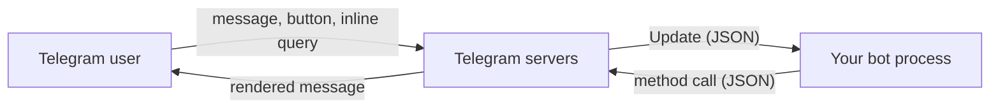

# Bot API Overview: How a Telegram Bot Actually Works

> **TL;DR:** A bot is a server that calls an HTTPS API. Telegram sends you *updates*, you send back *methods*. There is no persistent connection and no SDK requirement — just `https://api.telegram.org/bot<token>/<method>`.
> **Applies to:** Bot API 10.5 · python-telegram-bot 22.8 · Last verified 2026-11-26

## 1. The three moving parts



| Part | What it is | Who owns it |
| :--- | :--- | :--- |
| **Bot account** | A special Telegram user with a token instead of a password | You, via [@BotFather](https://t.me/BotFather) |
| **Updates** | JSON objects describing something that happened (`message`, `callback_query`, ...) | Produced by Telegram, consumed by you |
| **Methods** | JSON calls that do something (`sendMessage`, `answerCallbackQuery`, ...) | Called by you |

## 2. The raw API, with no library

```bash
curl "https://api.telegram.org/bot${BOT_TOKEN}/getMe"
curl -X POST "https://api.telegram.org/bot${BOT_TOKEN}/sendMessage" \
  -H "Content-Type: application/json" \
  -d '{"chat_id": 123456789, "text": "hello"}'
```

Every method is either `GET`/`POST` at `/bot<token>/<methodName>`. Responses are JSON with `ok: true|false`. On failure you get `error_code` and `description`; on rate limits you also get `parameters.retry_after`.

Knowing this matters when a library has not wrapped a brand-new method yet:

```python
# Call any Bot API method, even one the library does not know yet.
result = await context.bot.do_api_request(
    "sendMessageDraft",
    {"chat_id": chat_id, "draft_id": 1, "text": "partial..."},
)
```

## 3. Updates in, methods out

| Direction | Mechanism | Library equivalent |
| :--- | :--- | :--- |
| Telegram → bot | Long polling (`getUpdates`) or webhook POST | `app.run_polling()` / `app.run_webhook()` |
| Bot → Telegram | HTTPS method call | `context.bot.send_message(...)`, `update.message.reply_text(...)` |

`update.message.reply_text()` is a shortcut for `sendMessage` with `chat_id` and `reply_parameters` filled in.

## 4. What a handler really is

```python
from telegram import Update
from telegram.ext import ContextTypes

async def handler(update: Update, context: ContextTypes.DEFAULT_TYPE) -> None:
    # update: the parsed JSON, as Python objects
    # context: application-wide state (bot, job_queue, user_data, chat_data)
    await update.message.reply_text("ok")
```

Handlers are processed **group by group** in ascending order. Within one group, only the **first** handler that matches runs. Every group that has a match still runs, unless a handler raises `ApplicationHandlerStop` — that is how you stop propagation deliberately.

## 5. Versioning reality check

| Thing | Version at time of writing | Notes |
| :--- | :--- | :--- |
| Telegram Bot API | **10.5** (2026-11-22) | New methods appear a few times a year |
| python-telegram-bot | **22.8** (2026-06-12) | Natively supports Bot API **10.0** |
| Python | 3.11+ | `requires-python = ">=3.11"` in PTB 22.x |

Because the library trails the API, new features (rich messages, widgets, `setMySettings`, ephemeral messages) are reachable only through `do_api_request` until a release catches up. Check `telegram.__bot_api_version__` at runtime before relying on a field.

## 6. Minimal end-to-end checklist

1. Create the bot with [@BotFather](https://t.me/BotFather), get a token → [02-botfather-and-tokens.md](02-botfather-and-tokens.md)
2. Choose polling or webhooks → [03-polling-vs-webhooks.md](03-polling-vs-webhooks.md)
3. Subscribe only to the update types you need → [04-update-types-and-subscriptions.md](04-update-types-and-subscriptions.md)
4. Stay inside the limits → [05-limits-cheatsheet.md](05-limits-cheatsheet.md)
5. Harden secrets and the webhook → [../05-security/01-webhook-and-secrets.md](../05-security/01-webhook-and-secrets.md)

## Sources

- https://core.telegram.org/bots/api
- https://core.telegram.org/bots/api-changelog (Bot API 10.5, 2026-11-22)
- https://github.com/python-telegram-bot/python-telegram-bot (v22.8, supported Bot API 10.0)
