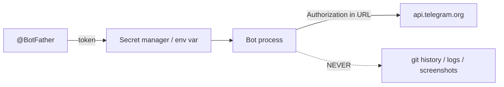

# BotFather and Bot Tokens

> **TL;DR:** The token is a password for your bot. Create it once, store it in a secret manager, never in git, and rotate it with `/revoke` the moment it leaks.
> **Applies to:** Bot API 10.5 · python-telegram-bot 22.8 · Last verified 2026-11-26

## 1. Creating a bot

1. Open [@BotFather](https://t.me/BotFather) and send `/newbot`.
2. Pick a display name and a username ending in `bot` (e.g. `acme_support_bot`).
3. BotFather replies with a token shaped like `123456789:AAH...`.

Useful BotFather commands:

| Command | Effect |
| :--- | :--- |
| `/newbot` | Create a bot |
| `/mybots` | List bots, edit settings, delete |
| `/token` | Show the token again |
| `/revoke` | **Invalidate the current token and issue a new one** |
| `/setdescription`, `/setabouttext` | Text shown before `/start` |
| `/setcommands` | Default command list (also settable via `setMyCommands`) |
| `/setprivacy` | Group privacy mode (see [06-privacy-mode-in-groups.md](06-privacy-mode-in-groups.md)) |
| `/setinline`, `/setjoingroups` | Enable inline mode, allow group joins |

## 2. Where the token must live



| Do | Don't |
| :--- | :--- |
| `os.environ["BOT_TOKEN"]` or a secrets manager | Hard-code it in a file |
| `.env` **ignored by git** | Commit `.env` |
| Rotate on suspicion | "It's only a test bot" (test bots still send messages to real users) |

`.gitignore` that actually protects you:

```gitignore
.env
*.pickle
*.session
```

## 3. Validate the token at startup

```python
from tgkit.config import Settings

settings = Settings.from_env()   # raises ValueError if BOT_TOKEN is missing or malformed
```

Then confirm it works once, before starting handlers:

```python
me = await app.bot.get_me()
print(me.username, me.id)
```

`getMe` returning `401 Unauthorized` means the token is wrong or revoked — fail fast instead of starting a loop of errors.

## 4. What a leaked token allows

Anyone with the token **is** the bot: they can read pending updates (including private messages sent while they poll), send messages as the bot, and change the webhook. Treat it exactly like a password.

Signs of a leak:

- Your webhook suddenly points somewhere you did not set (`getWebhookInfo`).
- Users report messages they never received, or a "new" welcome flow.
- Updates disappear because someone else is polling.

Response procedure: [../05-security/02-token-leak-response.md](../05-security/02-token-leak-response.md).

## 5. Keep it out of logs

HTTP client debug logs print full URLs, and the token is *in the URL*:

```python
import logging

logging.getLogger("httpx").setLevel(logging.WARNING)   # httpx is what PTB uses
logging.getLogger("telegram").setLevel(logging.INFO)

from tgkit.config import redact
print(redact("GET /bot123456789:AAH.../getMe"))   # GET /bot<bot-token>/getMe
```

## 6. Tokens and local Bot API servers

If you run your own Bot API server (`--local`), the token is still required and still secret. Moving between servers requires `logOut` on the old one — see [../04-advanced/06-local-bot-api-server.md](../04-advanced/06-local-bot-api-server.md).

## Sources

- https://core.telegram.org/bots/tutorial#obtain-your-bot-token
- https://core.telegram.org/bots/api#getme
- https://core.telegram.org/bots/api#getwebhookinfo
- https://github.com/python-telegram-bot/python-telegram-bot/blob/master/README.rst (Python 3.11+)
