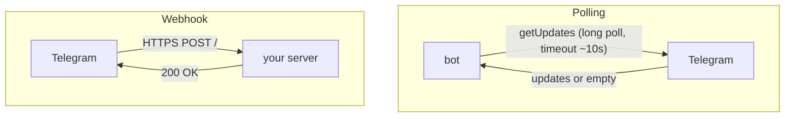

# Long Polling vs Webhooks

> **TL;DR:** Polling needs no public URL and is perfect for development and small bots. Webhooks are cheaper and lower-latency at scale, but need HTTPS, a public IPv4 address and correct secret handling. You cannot use both at once.
> **Applies to:** Bot API 10.5 · python-telegram-bot 22.8 · Last verified 2026-11-26

## 1. Side by side

| Dimension | Long polling (`getUpdates`) | Webhook (`setWebhook`) |
| :--- | :--- | :--- |
| Public address required | No | Yes: IPv4, HTTPS |
| Supported ports | any | **443, 80, 88, 8443** |
| TLS | not needed | TLS 1.2+, valid CN/SAN |
| Latency | one poll interval | immediate POST |
| Load | one long request per poll | one POST per update, up to `max_connections` (1–100, default 40) |
| Scaling | one consumer per token | several workers can share the endpoint |
| Local development | trivial | needs a tunnel (Cloudflare Tunnel, ngrok) |
| Can run both? | **No** — polling returns nothing while a webhook is set | **No** |



## 2. Polling, correctly

```python
app.run_polling(
    allowed_updates=Update.ALL_TYPES,   # or an explicit list
    drop_pending_updates=False,          # True only when you mean "skip the backlog"
    timeout=10,                          # long-poll timeout, in seconds
)
```

- `getUpdates` returns at most **100** updates per call and only **unconfirmed** ones.
- Confirmation is by offset: pass `offset = last_update_id + 1` and everything at or below it is dropped. PTB does this for you.
- If a second process polls the same token, updates are split between them unpredictably. Never run two pollers.

## 3. Webhooks, correctly

```python
app.run_webhook(
    listen="0.0.0.0",
    port=8443,
    url_path="telegram",                 # https://bot.example.com/telegram
    webhook_url="https://bot.example.com/telegram",
    secret_token=os.environ["WEBHOOK_SECRET"],   # header check, 1-256 chars [A-Za-z0-9_-]
    allowed_updates=Update.ALL_TYPES,
    max_connections=40,
)
```

Requirements from the official webhook guide:

| Requirement | Value |
| :--- | :--- |
| Source subnets | `149.154.160.0/20`, `91.108.4.0/22` |
| Ports | 443, 80, 88, 8443 |
| Protocol | HTTPS with TLS 1.2+ |
| Certificate | verified or self-signed uploaded via `certificate` |
| Redirects | not supported |
| CN/SAN | must match the domain exactly |

Harden the endpoint: [../05-security/01-webhook-and-secrets.md](../05-security/01-webhook-and-secrets.md).

## 4. Migration checklist

Polling → webhook:

1. Stop the poller (otherwise `getUpdates` keeps stealing updates while the webhook is being set).
2. Deploy the HTTPS endpoint, verify it returns `200` quickly.
3. `setWebhook` with `secret_token` and `allowed_updates`.
4. Check `getWebhookInfo`: `url`, `pending_update_count`, `last_error_message`.
5. Keep the old poller off. To go back: `deleteWebhook`, then start polling.

```python
info = await app.bot.get_webhook_info()
print(info.url, info.pending_update_count, info.last_error_message)
```

## 5. Choosing

| Situation | Choice |
| :--- | :--- |
| Local development, debugging | Polling |
| Serverless / scale-to-zero (Cloudflare Workers, Lambda) | Webhook |
| Thousands of updates per second | Webhook + queue |
| No public IP, restrictive network | Polling |
| Multiple workers behind a load balancer | Webhook |

## Sources

- https://core.telegram.org/bots/webhooks
- https://core.telegram.org/bots/api#getupdates
- https://core.telegram.org/bots/api#setwebhook
- https://core.telegram.org/bots/faq#how-do-i-get-updates
