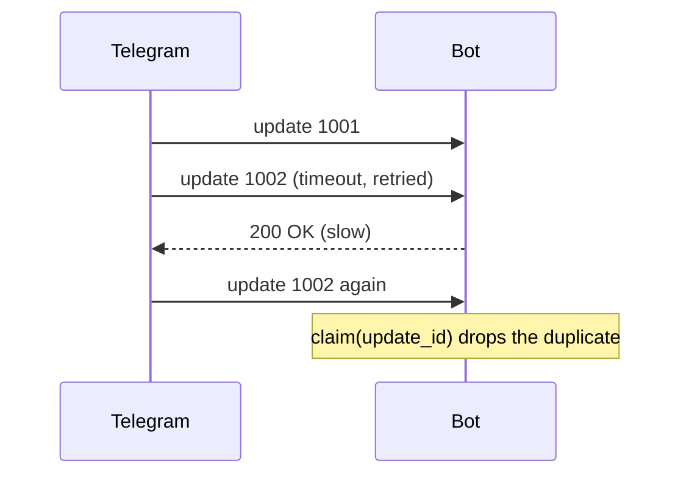

# Update Types and Subscriptions

> **TL;DR:** Telegram only sends the update types you ask for. Subscribe explicitly, handle the few you need, and remember that `allowed_updates` is a filter on the server, not a guarantee about ordering.
> **Applies to:** Bot API 10.5 · python-telegram-bot 22.8 · Last verified 2026-11-26

## 1. The `Update` object

`Update` is a container with at most **one** populated field (plus `update_id`). The field tells you what happened.

| Field | When it appears | Typical handler |
| :--- | :--- | :--- |
| `message` | new message in a chat | `MessageHandler` |
| `edited_message` | user edited a message | `MessageHandler(filters.UpdateType.EDITED_MESSAGE)` |
| `channel_post` / `edited_channel_post` | post in a channel | `MessageHandler` |
| `business_message`, `edited_business_message`, `deleted_business_messages` | business account chats | `MessageHandler` / `BusinessMessagesDeletedHandler` |
| `callback_query` | inline button pressed | `CallbackQueryHandler` |
| `inline_query` | user typed `@bot ...` | `InlineQueryHandler` |
| `chosen_inline_result` | user picked an inline result | `ChosenInlineResultHandler` |
| `shipping_query` / `pre_checkout_query` | payment flow | `ShippingQueryHandler` / `PreCheckoutQueryHandler` |
| `poll` / `poll_answer` | poll state changed / user voted | `PollHandler` / `PollAnswerHandler` |
| `my_chat_member` / `chat_member` | bot's or a user's membership changed | `ChatMemberHandler` |
| `chat_join_request` | join request to a guarded chat | `ChatJoinRequestHandler` |
| `message_reaction` / `message_reaction_count` | reactions changed | `MessageReactionHandler` |
| `chat_boost` / `removed_chat_boost` | boosts | `ChatBoostHandler` |
| `guest_message`, `widget_query`, `shared_widget_query` | newer Bot API 10.x features | raw / `do_api_request` until wrapped |
| `stopped_message_generation` | user pressed "stop" on a streamed draft | `MessageGenerationStopped` update (Bot API 10.3+) |

## 2. Subscribing

```python
from telegram import Update
from telegram.ext import ApplicationBuilder

app = ApplicationBuilder().token(token).build()
app.run_polling(
    allowed_updates=[
        Update.MESSAGE,
        Update.CALLBACK_QUERY,
        Update.PRE_CHECKOUT_QUERY,
    ]
)
```

If you omit `allowed_updates`, Telegram keeps the **previous** setting for that bot, which may be a list someone set months ago. Pass an explicit list (or `Update.ALL_TYPES`) so the subscription is deterministic. If the bot has no setting yet, Telegram's default is all types except `chat_member`, `message_reaction` and `message_reaction_count`.

> Reactions, `chat_member`, `message_reaction` and similar updates for chats require the bot to be an **administrator** with the matching right, and `allowed_updates` must include them explicitly.

## 3. Ordering and duplicates

- Updates for a chat arrive roughly in order, but **do not assume global ordering**.
- Retries happen: webhook timeouts cause Telegram to re-deliver. Use [../03-state/03-idempotent-updates.md](../03-state/03-idempotent-updates.md).
- `update_id` increases, but gaps are normal.



## 4. Which handler for which update

| You want | Handler | Filter |
| :--- | :--- | :--- |
| `/start` only | `CommandHandler("start", fn)` | — |
| any text but commands | `MessageHandler` | `filters.TEXT & ~filters.COMMAND` |
| photos and videos | `MessageHandler` | `filters.PHOTO \| filters.VIDEO` |
| button presses | `CallbackQueryHandler(fn)` | optional `pattern=` |
| joins/leaves | `ChatMemberHandler` | `ChatMemberHandler.CHAT_MEMBER` |
| successful payment | `MessageHandler` | `filters.SUCCESSFUL_PAYMENT` |

## 5. Group order and stopping propagation

Handlers run by `group` (ascending); inside a group, registration order decides, and only the first match in that group runs. `group=-1` is a common place for cross-cutting middleware such as de-duplication or logging.

```python
from telegram.ext import ApplicationHandlerStop, TypeHandler

async def block_banned(update, context):
    if update.effective_user and update.effective_user.id in BANNED:
        raise ApplicationHandlerStop   # nothing after this sees the update

app.add_handler(TypeHandler(Update, block_banned), group=-1)
```

## Sources

- https://core.telegram.org/bots/api#update
- https://core.telegram.org/bots/api#getupdates (`allowed_updates`)
- https://core.telegram.org/bots/api-changelog (10.0–10.5, 2026)
