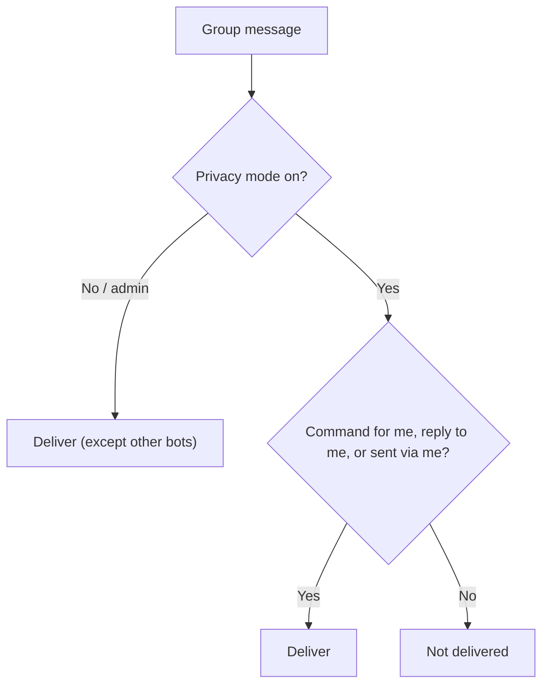

# Privacy Mode: Why Your Bot Ignores Group Messages

> **TL;DR:** With privacy mode on (the default), a bot in a group only receives commands addressed to it, replies to it, messages sent via it, and general commands when it was the last bot to speak. Turn privacy mode off in @BotFather only if the bot genuinely needs every message.
> **Applies to:** Bot API 10.5 · python-telegram-bot 22.8 · Last verified 2026-11-26

## 1. What a bot receives

| Mode | Receives |
| :--- | :--- |
| **All bots, always** | service messages; all private-chat messages; all messages in channels where the bot is a member |
| **Privacy disabled**, or bot is an admin | all messages **except** messages from other bots |
| **Privacy enabled** (default) | commands meant for it (`/cmd@this_bot`), general commands like `/start` **if** it was the last bot to send a message, messages sent via it, replies to its messages |

One more rule: a given message reaches only **one** privacy-enabled bot. Replies win over everything else.



## 2. Toggling it

In [@BotFather](https://t.me/BotFather): `/mybots` → your bot → **Bot Settings** → **Group Privacy** → **Turn off**.

Important: the change applies to **new** group memberships. If the bot is already in a group, remove and re-add it (or have an admin re-add it) before testing.

## 3. Design for privacy mode

| Goal | Approach |
| :--- | :--- |
| Respond to `hello` without a slash | Not possible with privacy mode on in groups. Use a command, a reply, or a button. |
| Moderation of every message | Disable privacy mode **and** make the bot an admin |
| Per-chat settings | Store settings keyed by `chat.id`, not by message content |
| Avoid loops | Bots never receive messages from other bots; still guard against self-replies |

## 4. Detecting the situation in code

```python
from telegram import Chat
from telegram.constants import ChatType

async def on_message(update, context):
    chat = update.effective_chat
    if chat and chat.type in (ChatType.GROUP, ChatType.SUPERGROUP):
        # With privacy mode on, you will only see a subset of messages.
        # Do not infer "the group is quiet" from "I received nothing".
        pass
```

You can read your own status to know whether you are an admin:

```python
me = await context.bot.get_chat_member(chat_id, context.bot.id)
print(me.status)   # 'administrator', 'member', 'left', ...
```

## 5. Pitfalls

- **"It worked in private chat."** Private chats always deliver everything; groups do not.
- **Privacy change without re-adding.** Old memberships keep the old setting.
- **Channel posts.** Channels behave differently from groups; a bot must be a member (usually admin) to see posts.
- **`chat_member` updates** are only delivered to admins and only if `allowed_updates` includes them.

## Sources

- https://core.telegram.org/bots/faq#what-messages-will-my-bot-get
- https://core.telegram.org/bots/features#privacy-mode
- https://core.telegram.org/bots/api#getchatmember
