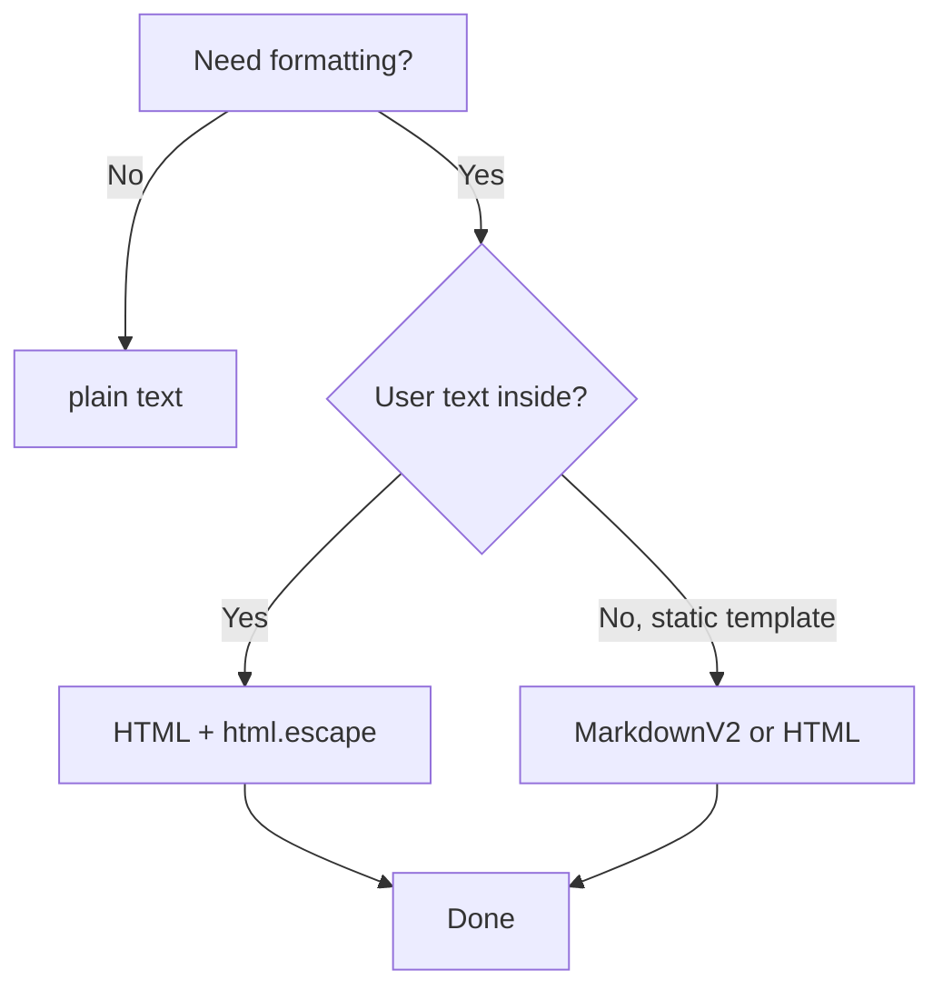

# Formatting: HTML, MarkdownV2 and Entities

> **TL;DR:** Pick **one** parse mode and escape user input for it. HTML is the most forgiving; MarkdownV2 needs escaping of many characters. Never interpolate raw user text into a formatted string.
> **Applies to:** Bot API 10.5 · python-telegram-bot 22.8 · Last verified 2026-11-26

## 1. Three ways to format

| Way | When to use | Risk |
| :--- | :--- | :--- |
| `parse_mode="HTML"` | almost always; tags are explicit | unescaped `<`, `>`, `&` from users |
| `parse_mode="MarkdownV2"` | you want Markdown syntax | many characters must be escaped |
| `entities=[...]` | you build text programmatically and know exact offsets | offset math is easy to get wrong |

Plain text (no `parse_mode`) is always safe and is the right default for echo-style features.

## 2. HTML

Supported subset: `<b>`, `<i>`, `<u>`, `<s>`, `<span class="tg-spoiler">`, `<a href="...">`, `<code>`, `<pre>`, `<blockquote>`, `<tg-emoji>`.

```python
from html import escape

name = update.effective_user.first_name          # attacker-controlled
text = f"Hello <b>{escape(name)}</b>!"
await update.message.reply_text(text, parse_mode="HTML")
```

`html.escape(name)` turns `<script>` into `&lt;script&gt;`, which is what you want. Without it Telegram returns `400 Bad Request: can't parse entities`.

## 3. MarkdownV2

MarkdownV2 reserves `_ * [ ] ( ) ~ ` > # + - = | { } . !`. Escape them or the call fails. Do not maintain your own escape table:

```python
from telegram.helpers import escape_markdown

text = escape_markdown(user_text, version=2)
await update.message.reply_text(f"*Bold*\n{text}", parse_mode="MarkdownV2")
```

Rule of thumb: format the **template** with Markdown, escape the **data** separately, then concatenate. Never escape the whole final string, or your own `*` disappears.

## 4. Entities instead of parse mode

```python
from telegram import MessageEntity

text = "click here"
entity = MessageEntity(type=MessageEntity.TEXT_LINK, offset=0, length=5, url="https://example.com")
await update.message.reply_text(text, entities=[entity])
```

Offsets are counted in **UTF-16 code units** by the Bot API, while Python's `len()` counts code points. Emoji and characters outside the BMP therefore shift offsets. If you use entities with user-supplied text, compute offsets on the UTF-16 representation:

```python
def utf16_len(text: str) -> int:
    return len(text.encode("utf-16-le")) // 2
```

## 5. Which one to choose



## 6. Pitfalls

- **Mixing modes.** `parse_mode` and `entities` cannot be combined.
- **Nested tags.** HTML tags must be properly nested; `<b><i>x</b></i>` is rejected.
- **Links in MarkdownV2** need `[text](url)` with the URL's `)` escaped.
- **Captions** have the same formatting rules but a 1024 character limit.
- **Editing** with a different parse mode than the original can leave stale entities; send `entities=[]` or re-send.

## Sources

- https://core.telegram.org/bots/api#formatting-options
- https://core.telegram.org/bots/api#messageentity
- `telegram.helpers.escape_markdown` in python-telegram-bot 22.8
