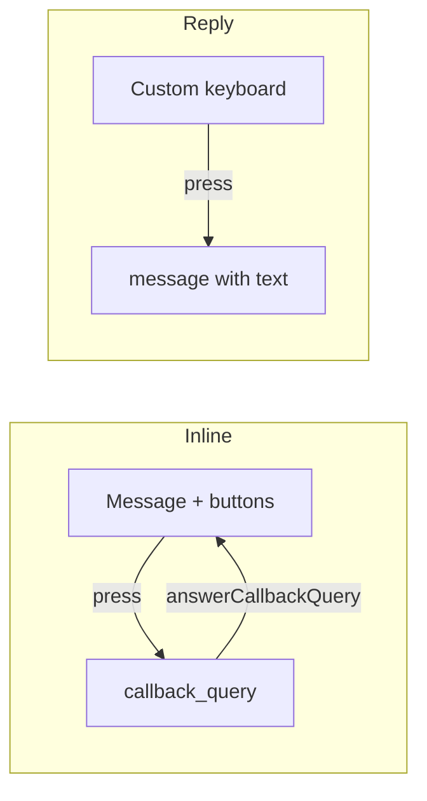

# Keyboards: Inline vs Reply

> **TL;DR:** Inline keyboards live under a message and send `callback_query` updates. Reply keyboards replace the user's keyboard and send normal messages. Inline is the default choice; reply keyboards are for fast repeated input.
> **Applies to:** Bot API 10.5 · python-telegram-bot 22.8 · Last verified 2026-11-26

## 1. Comparison

| Dimension | Inline keyboard | Reply keyboard |
| :--- | :--- | :--- |
| Placement | attached to a message | replaces the device keyboard |
| Sends | `callback_query` update | a normal `message` |
| Can be edited later | yes (`editMessageReplyMarkup`) | no |
| Visible to others in a group | yes, part of the message | only to the user whose keyboard it is |
| Buttons | text, `url`, `callback_data`, `web_app`, `login_url`, `switch_inline_query`, `pay` | text, request contact/location/poll, `web_app` |
| Best for | menus, pagination, confirmations | forms, "share my phone number", quick choices |



## 2. Inline keyboard

```python
from telegram import InlineKeyboardButton, InlineKeyboardMarkup
from tgkit.callback_data import pack_callback

markup = InlineKeyboardMarkup([
    [
        InlineKeyboardButton("Yes", callback_data=pack_callback("confirm", 1)),
        InlineKeyboardButton("No",  callback_data=pack_callback("confirm", 0)),
    ],
    [InlineKeyboardButton("Docs", url="https://core.telegram.org/bots/api")],
])
await update.message.reply_text("Delete this item?", reply_markup=markup)
```

Rules that save debugging time:

- `callback_data` is **1–64 bytes** of UTF-8. `pack_callback` raises before Telegram does.
- `url` buttons must be `http(s)://` or `tg://`.
- A row can hold several buttons; keep labels short so they do not wrap.
- Treat `callback_data` as public: it leaves your server, is stored by the client and is echoed back. Never put secrets in it.

## 3. Reply keyboard

```python
from telegram import KeyboardButton, ReplyKeyboardMarkup, ReplyKeyboardRemove

keyboard = ReplyKeyboardMarkup(
    [[KeyboardButton("Share my phone", request_contact=True)],
     [KeyboardButton("Share location", request_location=True)]],
    resize_keyboard=True,        # fit the buttons to the screen
    one_time_keyboard=True,      # hide after one use
    input_field_placeholder="Pick one",
)
await update.message.reply_text("How can we reach you?", reply_markup=keyboard)

# remove it later
await update.message.reply_text("Thanks!", reply_markup=ReplyKeyboardRemove())
```

The buttons send ordinary messages, so your handler must match their text (or the `contact`/`location` field):

```python
from telegram.ext import MessageHandler, filters

app.add_handler(MessageHandler(filters.CONTACT, on_contact))
app.add_handler(MessageHandler(filters.LOCATION, on_location))
app.add_handler(MessageHandler(filters.Regex("^Share my phone$"), on_phone_text))
```

## 4. Editing and removing

```python
# change the buttons without sending a new message
await query.edit_message_reply_markup(reply_markup=new_markup)

# remove them entirely
await query.edit_message_reply_markup(reply_markup=None)
```

Editing fails with `400 Bad Request: message is not modified` if nothing changed — catch it or check first.

## 5. When buttons are the wrong answer

| Problem | Better tool |
| :--- | :--- |
| More than ~8 choices | inline mode, or a Mini App |
| Free-form input | just ask for text |
| Complex form | conversation handler or Mini App |
| Per-user long-lived menu | `setMyCommands` + commands |

## Sources

- https://core.telegram.org/bots/api#inlinekeyboardmarkup
- https://core.telegram.org/bots/api#replykeyboardmarkup
- https://core.telegram.org/bots/api#keyboardbutton
- https://core.telegram.org/bots/features#keyboards
