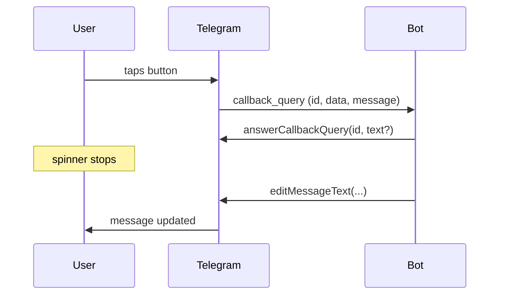

# Callback Queries: Buttons That Do Something

> **TL;DR:** Every `callback_query` must be answered with `answerCallbackQuery`. Answer first (fast), then do the slow work. Store state outside the callback data.
> **Applies to:** Bot API 10.5 · python-telegram-bot 22.8 · Last verified 2026-11-26

## 1. Lifecycle



If you never answer, the client shows a spinner until it gives up, and Telegram reports the callback as unhandled.

## 2. Handler

```python
from telegram import Update
from telegram.ext import CallbackQueryHandler, ContextTypes
from tgkit.callback_data import unpack_callback

async def on_callback(update: Update, context: ContextTypes.DEFAULT_TYPE) -> None:
    query = update.callback_query
    if query is None:
        return

    # 1. Answer immediately. show_alert=True opens a modal dialog.
    await query.answer()

    # 2. Parse defensively: old messages can outlive your code.
    try:
        action, parts = unpack_callback(query.data or "")
    except ValueError:
        await query.answer("This menu is outdated.", show_alert=True)
        return

    if action == "confirm":
        await query.edit_message_text("Confirmed." if parts[0] == "1" else "Cancelled.")

app.add_handler(CallbackQueryHandler(on_callback))
```

## 3. Answering well

| Goal | Call |
| :--- | :--- |
| silent ack | `await query.answer()` |
| toast message | `await query.answer("Saved")` |
| modal dialog | `await query.answer("Are you sure?", show_alert=True)` |
| open a URL | `await query.answer(url="https://...")` |

`show_alert=True` blocks the UI until dismissed — reserve it for errors.

## 4. Editing safely

```python
from telegram.error import BadRequest

try:
    await query.edit_message_text("New text")
except BadRequest as exc:
    if "message is not modified" in str(exc):
        pass          # the user pressed the same button twice
    elif "message to edit not found" in str(exc):
        await query.message.reply_text("New text")   # original was deleted
    else:
        raise
```

Editing a message that contains media requires `edit_message_caption`, not `edit_message_text`.

## 5. State: do not put it in the button

`callback_data` is limited to 64 bytes and is echoed back to you — it is not a database.

| Wrong | Right |
| :--- | :--- |
| `callback_data="cart:user42:item9:qty3:price150"` | `callback_data="v1:cart:9"` + lookup in Redis/DB |
| Long JSON in callback data | short id + server-side state |
| Secrets, tokens, PII | never |

## 6. Pattern matching and multiple handlers

```python
from telegram.ext import CallbackQueryHandler

# Only handles data starting with "v1:page:"
app.add_handler(CallbackQueryHandler(on_page, pattern=r"^v1:page:"))
# Catch-all, lower priority
app.add_handler(CallbackQueryHandler(on_other))
```

Handlers are matched in group order; a catch-all in group 0 runs after a specific handler in group 0 **only if** the specific one did not match.

## 7. Pitfalls

- **Answering twice** — second call fails with `query is too old`.
- **Slow work before answering** — users see a spinner; answer first.
- **Assuming the message still exists** — users delete messages; handle "message to edit not found".
- **Long callbacks** — a handler that takes 30 s blocks that update; offload to a job or task.

## Sources

- https://core.telegram.org/bots/api#callbackquery
- https://core.telegram.org/bots/api#answercallbackquery
- https://core.telegram.org/bots/api#editmessagetext
