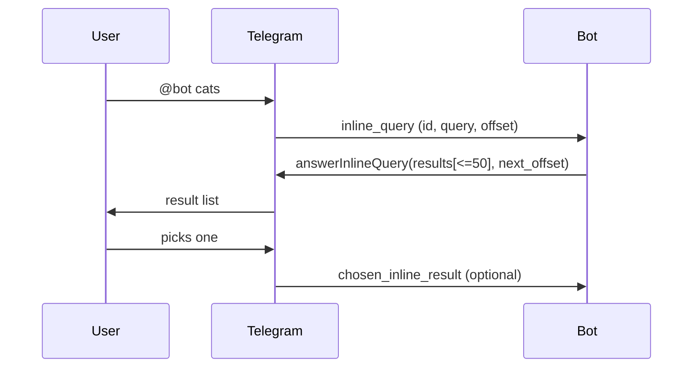

# Inline Mode: `@yourbot query` Anywhere

> **TL;DR:** Enable inline mode in @BotFather, answer `inline_query` within a few seconds with up to 50 results, and paginate with `next_offset`. Inline results are sent by the user, not the bot, so they work in chats the bot has never joined.
> **Applies to:** Bot API 10.5 · python-telegram-bot 22.8 · Last verified 2026-11-26

## 1. Enable it

@BotFather → `/mybots` → your bot → **Bot Settings** → **Inline Mode** → **Turn on**.
Optionally set a placeholder and a "Switch to PM" button.

## 2. Flow



## 3. Minimal handler

```python
from telegram import InlineQueryResultArticle, InputTextMessageContent, Update
from telegram.ext import ContextTypes

async def inline(update: Update, context: ContextTypes.DEFAULT_TYPE) -> None:
    query = update.inline_query
    if query is None:
        return

    text = (query.query or "").strip()[:200]
    results = [
        InlineQueryResultArticle(
            id="echo",                       # unique per result, max 64 bytes
            title="Send as message",
            description=text or "empty",
            input_message_content=InputTextMessageContent(text or "hi"),
        )
    ]
    await query.answer(
        results=results,
        cache_time=30,        # seconds; 0 disables caching
        is_personal=True,     # results depend on the user, do not share cache
    )
```

## 4. Limits and behaviour

| Limit | Value |
| :--- | :--- |
| Results per answer | **50** |
| `next_offset` | up to 64 characters |
| Query text | up to 256 characters |
| Result `id` | 1–64 bytes, unique in the answer |
| Answer deadline | a few seconds; late answers are ignored |

Pagination:

```python
start = int(query.offset or 0)
page = all_items[start:start + 20]
next_offset = str(start + 20) if start + 20 < len(all_items) else ""
await query.answer(results=page, next_offset=next_offset)
```

`next_offset=""` tells the client there is nothing more.

## 5. Caching rules

| Situation | `cache_time` / flags |
| :--- | :--- |
| Same results for everyone | `cache_time=300` (default is server-side) |
| Results depend on the user | `is_personal=True` |
| Results depend on the chat | `is_personal=True`, plus check `query.chat_type` |
| Results change fast (prices) | low `cache_time` (e.g. 5–30) |

## 6. Result types

| Type | Use |
| :--- | :--- |
| `InlineQueryResultArticle` | text messages |
| `InlineQueryResultPhoto`, `Video`, `Gif`, `Document` | media |
| `InlineQueryResultLocation`, `Venue`, `Contact` | places and contacts |
| `InlineQueryResultCachedPhoto`, `CachedVideo`, ... | re-send by `file_id` (fast, no upload) |

Cached results are the cheapest option: you send a `file_id` you already have.

## 7. Pitfalls

- **No results** usually means inline mode is off or the handler raised.
- **Shared cache leaking personal data** — always set `is_personal=True` for per-user results.
- **Duplicate ids** in one answer are rejected.
- **Assuming the bot is in the chat** — inline results are sent by the user; the bot may have no access.
- **`chosen_inline_result` requires enabling** it separately in @BotFather.

## Sources

- https://core.telegram.org/bots/api#inline-mode
- https://core.telegram.org/bots/api#inlinequery
- https://core.telegram.org/bots/api#answerinlinequery
- https://core.telegram.org/bots/api#inlinequeryresult
