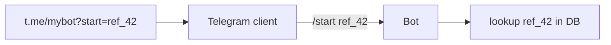

# Deep Links and Referral Payloads

> **TL;DR:** `https://t.me/<bot>?start=<payload>` opens the bot and delivers `/start <payload>`. Keep the payload under 64 characters, treat it as untrusted input, and use it for attribution — not for identity.
> **Applies to:** Bot API 10.5 · python-telegram-bot 22.8 · Last verified 2026-11-26

## 1. Formats

| Link | Result |
| :--- | :--- |
| `https://t.me/mybot` | opens the chat, no payload |
| `https://t.me/mybot?start=ref_42` | sends `/start ref_42` |
| `https://t.me/mybot?startgroup=true` | opens a group picker to add the bot |
| `https://t.me/mybot?startchannel=true` | opens a channel picker |
| `https://t.me/mybot?startapp=promo` | opens the **main Mini App** with `start_param=promo` |



## 2. Generating links

```python
from telegram.helpers import create_deep_linked_url

url = create_deep_linked_url("mybot", "ref_42")     # https://t.me/mybot?start=ref_42
```

Do not build it with string concatenation; the helper handles encoding.

## 3. Reading the payload

```python
async def start(update, context):
    payload = context.args[0] if context.args else None
    if payload and payload.startswith("ref_"):
        await record_referral(update.effective_user.id, payload)
    await update.message.reply_text("Welcome!")
```

`context.args` is the list of whitespace-separated arguments after the command.

## 4. What the payload may contain

| Allowed | Not allowed |
| :--- | :--- |
| `A-Z a-z 0-9 _ -` | spaces, `?`, `&`, `#`, non-ASCII |
| short ids, campaign names | user ids you have not verified, tokens, PII |

Always validate with a whitelist:

```python
import re

PAYLOAD = re.compile(r"^[A-Za-z0-9_-]{1,64}$")

def valid(payload: str | None) -> bool:
    return bool(payload and PAYLOAD.fullmatch(payload))
```

## 5. Attribution without trusting the link

A deep-link payload proves **only** that the user clicked a link with that payload. It does not prove who referred them, and users can type any payload. Store `(user_id, payload, timestamp)` and apply business rules server-side.

## 6. Pitfalls

- **Over 64 characters** → the payload is not delivered reliably; keep it short.
- **Case sensitivity** — treat payloads case-sensitively, and store them exactly.
- **`startgroup` payloads** arrive in the group, not in private chat.
- **Mini App links** use `startapp`, which arrives as `start_param`, not in `context.args`.

## Sources

- https://core.telegram.org/bots/features#deep-linking
- https://core.telegram.org/bots/api#setwebhook (deep linking section in features)
- `telegram.helpers.create_deep_linked_url`
