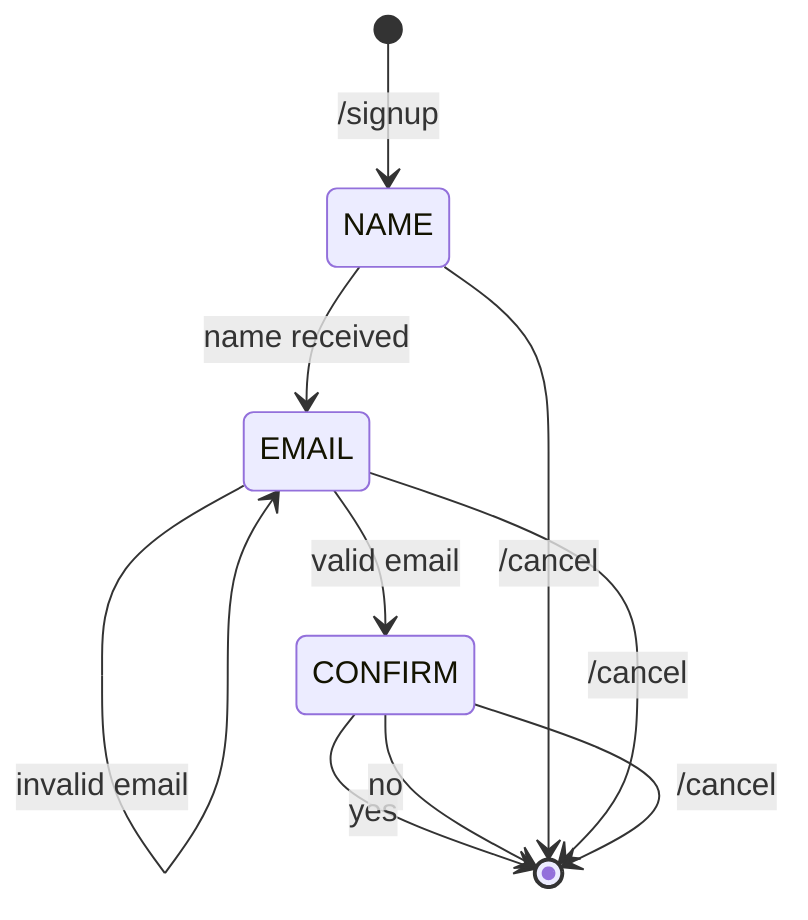

# Conversations: Multi-Step Flows Without a Mess

> **TL;DR:** Use `ConversationHandler` for short, linear flows; use a database-backed state machine for anything long-lived, resumable or shared between workers. Always provide an escape hatch (`/cancel`) and a timeout.
> **Applies to:** Bot API 10.5 · python-telegram-bot 22.8 · Last verified 2026-11-26

## 1. The two designs

| Design | State lives in | Survives restart | Works with N workers | Good for |
| :--- | :--- | :--- | :--- | :--- |
| `ConversationHandler` | `user_data` (in memory, or persistence) | only with `PicklePersistence` | no (memory is per process) | short flows: forms, wizards |
| Explicit state machine | your database / Redis | yes | yes | onboarding, checkout, anything with money |



## 2. ConversationHandler, correctly

```python
from telegram.ext import ConversationHandler, CommandHandler, MessageHandler, filters

NAME, EMAIL, CONFIRM = range(3)

conv = ConversationHandler(
    entry_points=[CommandHandler("signup", begin)],
    states={
        NAME: [MessageHandler(filters.TEXT & ~filters.COMMAND, got_name)],
        EMAIL: [MessageHandler(filters.TEXT & ~filters.COMMAND, got_email)],
        CONFIRM: [MessageHandler(filters.Regex(r"^(?i:yes|no)$"), confirm)],
    },
    fallbacks=[CommandHandler("cancel", cancel)],
    conversation_timeout=600,     # seconds; ends abandoned conversations
    allow_reentry=True,           # /signup restarts even mid-conversation
)
app.add_handler(conv)
```

Non-negotiables:

1. **A fallback for every conversation.** Without `/cancel`, a user can get stuck forever.
2. **A timeout.** `conversation_timeout` ends idle conversations; handle the timeout in `fallbacks` if you need to notify the user.
3. **Clear state on entry and exit.** `context.user_data.clear()` prevents half-filled forms.
4. **Validate each step.** Never trust that the previous step ran.

## 3. Handler ordering inside a state

Inside a state, handlers are tried in order. Put the specific ones first:

```python
states={
    EMAIL: [
        MessageHandler(filters.Regex(r"^skip$"), skip_email),   # specific
        MessageHandler(filters.TEXT & ~filters.COMMAND, got_email),
    ],
}
```

## 4. When the conversation outgrows the handler

Move to explicit state:

```python
# state table: one row per user
# user_id | step | data(json) | updated_at

async def on_text(update, context):
    row = await db.get_state(update.effective_user.id)
    step = row.step if row else "idle"
    if step == "await_email":
        ...
        await db.set_state(user_id, "await_confirm", {"email": text})
```

Benefits: survives restarts and redeploys, works behind a load balancer, is inspectable and debuggable.

## 5. Concurrency trap

`ConversationHandler` keeps per-chat state in the process. With `concurrent_updates`, two messages from the same chat can be processed in parallel and race on that state. Either:

- process per-chat updates serially (use a per-chat lock), or
- move state to the database and make transitions atomic (`UPDATE ... WHERE step = 'old'`).

## 6. Pitfalls

- **`user_data` is not durable.** A restart loses it unless you configure persistence.
- **Conversation handlers and callback queries.** A button press inside a conversation needs a `CallbackQueryHandler` in that state.
- **Nested conversations** get confusing fast; flatten them.
- **Global handlers still run.** A `MessageHandler` registered outside the conversation can steal the message before the state sees it — check group order.

## Sources

- https://docs.python-telegram-bot.org/en/stable/telegram.ext.conversationhandler.html
- https://core.telegram.org/bots/api#update
