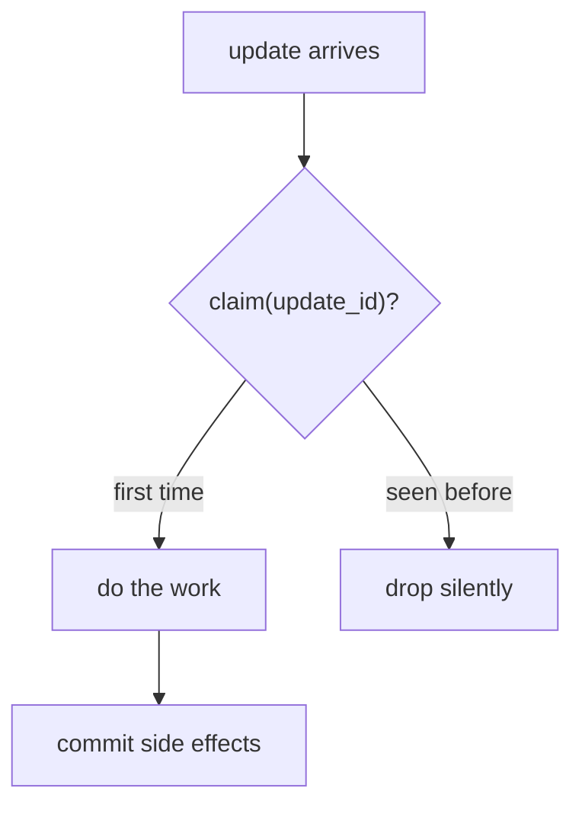

# Idempotent Updates: Never Charge Twice

> **TL;DR:** Telegram re-delivers updates when a webhook times out or a process restarts. Claim each `update_id` exactly once before doing side effects, using a durable store.
> **Applies to:** Bot API 10.5 · python-telegram-bot 22.8 · Last verified 2026-11-26

## 1. Why duplicates happen

| Cause | What Telegram does |
| :--- | :--- |
| Webhook handler slower than the timeout | retries the same update |
| Process crash after receiving, before `200 OK` | retries |
| Polling restarted without confirming offset | re-sends unconfirmed updates |
| Two workers behind a load balancer | each may receive a copy |

## 2. The claim pattern



```python
from tgkit.idempotency import SQLiteUpdateStore

store = SQLiteUpdateStore("updates.db")

async def guard(update, context):
    if not store.claim(update.update_id):
        raise ApplicationHandlerStop      # stop all further handlers
```

Register it in `group=-1` so it runs before anything else.

## 3. Choose the right store

| Store | Durability | Multi-worker | Use when |
| :--- | :--- | :--- | :--- |
| `MemoryUpdateStore` | none | no | single process, best-effort |
| `SQLiteUpdateStore` | disk | yes, same host | one host, several processes |
| Redis `SET NX EX` | depends on config | yes | distributed workers |
| Postgres unique index | yes | yes | you already have Postgres |

Redis:

```python
key = f"tg:update:{update.update_id}"
if not await redis.set(key, "1", nx=True, ex=7 * 24 * 3600):
    raise ApplicationHandlerStop
```

## 4. Side effects must be idempotent too

A claim protects against duplicate *updates*, not duplicate *work* after a crash between the side effect and the commit. Make the effect itself idempotent:

| Effect | Idempotent key |
| :--- | :--- |
| Payment delivered | `telegram_payment_charge_id` (unique per payment) |
| Order created | `(user_id, idempotency_key)` unique index |
| Email sent | message id in a `sent` table |
| File stored | content hash |

```python
# payments: the charge id is your natural key
if await db.payment_exists(payment.telegram_payment_charge_id):
    return
await db.insert_payment(payment.telegram_payment_charge_id, ...)
```

## 5. Cleanup

Claims must expire, or the table grows forever.

```python
store.prune()      # deletes rows older than the TTL
```

Run it from a daily `JobQueue` job or a cron entry.

## 6. What not to do

- **Claim before validation.** Validate the update first if validation is cheap and side-effect free; otherwise you can "consume" an update you then reject.
- **Use the message id as the key.** Edits and re-sends reuse message ids; `update_id` is the right unit.
- **Assume ordering.** Idempotency protects correctness, not sequence.

## Sources

- https://core.telegram.org/bots/webhooks (retry behaviour)
- https://core.telegram.org/bots/api#update (`update_id`)
- https://core.telegram.org/bots/payments-stars (`telegram_payment_charge_id`)
