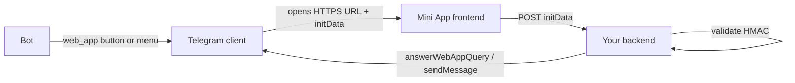

# Mini Apps: Overview and Launch Modes

> **TL;DR:** A Mini App is a web page opened inside Telegram with `Telegram.WebApp`. It gets signed `initData` you must validate on your server. There are seven launch modes; pick the one that matches how much chat access you need.
> **Applies to:** Bot API 10.5 · python-telegram-bot 22.8 · Last verified 2026-11-26

## 1. What a Mini App is

| Part | Runs where | Responsibility |
| :--- | :--- | :--- |
| Frontend | user's device, inside Telegram | UI, calls `Telegram.WebApp` |
| `initData` | passed to the page | proof of who opened it, **only after server validation** |
| Your backend | your server | validates `initData`, serves data, calls Bot API |
| Bot | your server | creates buttons/links, sends messages after actions |



## 2. Launch modes

| Mode | How | Chat access |
| :--- | :--- | :--- |
| Keyboard button | `KeyboardButton(web_app=WebAppInfo(url))` | can `sendData` back to the bot |
| Inline button | `InlineKeyboardButton(web_app=...)` | can answer via `answerWebAppQuery` |
| Menu button | `setChatMenuButton(MenuButtonWebApp(...))` | like inline button |
| Main Mini App | @BotFather, profile "Launch app" | `https://t.me/bot?startapp=...` |
| Direct link | `https://t.me/bot/appname?startapp=...` | no chat access |
| Inline mode | `InlineQueryResultsButton(web_app=...)` | no chat access |
| Attachment menu | @BotFather `/setattach` (advertisers, test server) | full chat context |

## 3. Minimal frontend

```html
<!doctype html>
<html>
  <head>
    <meta charset="utf-8" />
    <meta name="viewport" content="width=device-width, initial-scale=1" />
    <script src="https://telegram.org/js/telegram-web-app.js"></script>
  </head>
  <body>
    <button id="go">Confirm</button>
    <script>
      const tg = window.Telegram.WebApp;
      tg.ready();
      tg.expand();
      document.getElementById("go").onclick = async () => {
        await fetch("/api/confirm", {
          method: "POST",
          headers: { "Content-Type": "application/json" },
          body: JSON.stringify({ initData: tg.initData }),
        });
        tg.close();
      };
    </script>
  </body>
</html>
```

Two rules:

1. Load `telegram-web-app.js` **before** your own scripts.
2. Send `tg.initData` (the raw string), not `initDataUnsafe`.

## 4. Minimal backend

```python
from tgkit.initdata import validate_init_data

def user_id_from_init_data(init_data: str, token: str) -> int:
    data = validate_init_data(init_data, token, max_age_seconds=3600)
    return int(data["user"]["id"])
```

Details and the Ed25519 variant: [02-miniapp-initdata-validation.md](02-miniapp-initdata-validation.md).

## 5. Security rules

| Rule | Why |
| :--- | :--- |
| Validate `initData` on **every** request | it is the only proof of identity |
| Never trust `initDataUnsafe` | it is client-side and trivially edited |
| Check `auth_date` | limits replay of an old payload |
| Serve over HTTPS | required by Telegram and by common sense |
| Keep the Mini App origin fixed | since 2026-07-20 Telegram blocks Mini App API calls from other origins by default |

## 6. Limits and behaviour worth knowing

| Thing | Value |
| :--- | :--- |
| `sendData` payload | up to 4096 bytes, keyboard-button mode only |
| Main Mini App link | `https://t.me/<bot>?startapp=<param>` |
| Compact mode | add `mode=compact` to open at half height |
| Fullscreen | `tg.requestFullscreen()` (Bot API 8.0+) |

## Sources

- https://core.telegram.org/bots/webapps
- https://core.telegram.org/bots/api-changelog (10.2 origin hardening, 10.1 `chat_join_request_query_id`)
- https://core.telegram.org/bots/webapps#initializing-mini-apps
