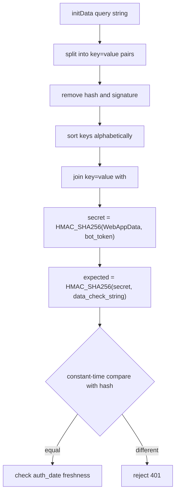

# Validating Mini App `initData`

> **TL;DR:** Compute `secret = HMAC_SHA256(key="WebAppData", msg=bot_token)`, then compare `hash` with `HMAC_SHA256(key=secret, msg=data_check_string)`. The data-check-string is every field except `hash` and `signature`, sorted, joined by `\n`. Always check `auth_date`.
> **Applies to:** Bot API 10.5 · python-telegram-bot 22.8 · Last verified 2026-11-26

## 1. The algorithm



## 2. Using the helper

```python
from tgkit.initdata import InitDataError, validate_init_data

try:
    data = validate_init_data(raw_init_data, bot_token, max_age_seconds=3600)
except InitDataError as exc:
    raise HTTPException(status_code=401, detail=str(exc))

user = data["user"]          # already JSON-decoded
print(user["id"], user["first_name"])
```

## 3. Implementing it yourself (so you can audit it)

```python
import hashlib, hmac
from urllib.parse import parse_qsl

def validate(init_data: str, bot_token: str) -> dict[str, str]:
    fields = dict(parse_qsl(init_data, keep_blank_values=True))
    received = fields.pop("hash", None)
    fields.pop("signature", None)          # signature is for the Ed25519 scheme
    if not received:
        raise ValueError("missing hash")

    check = "\n".join(f"{k}={fields[k]}" for k in sorted(fields))
    secret = hmac.new(b"WebAppData", bot_token.encode(), hashlib.sha256).digest()
    expected = hmac.new(secret, check.encode(), hashlib.sha256).hexdigest()

    if not hmac.compare_digest(expected, received):
        raise ValueError("hash mismatch")
    return fields
```

## 4. Third-party validation (Ed25519)

If a service does not have your bot token, Telegram provides an Ed25519 signature in the `signature` field.

| Input | Value |
| :--- | :--- |
| Public key (production) | `e7bf03a2fa4602af4580703d88dda5bb59f32ed8b02a56c187fe7d34caed242d` |
| Public key (test) | `40055058a4ee38156a06562e52eece92a771bcd8346a8c4615cb7376eddf72ec` |
| data-check-string | `"<bot_id>:WebAppData\n"` + sorted `key=value` lines, excluding `hash` and `signature` |

```python
from tgkit.initdata import validate_init_data_ed25519

data = validate_init_data_ed25519(raw_init_data, bot_id=123456789)
```

## 5. Failure modes and what they mean

| Error | Meaning |
| :--- | :--- |
| `missing hash` | not real initData, or you sent `initDataUnsafe` |
| `hash mismatch` | wrong bot token, tampered field, or you included `hash` in the check string |
| `missing or invalid auth_date` | malformed payload |
| `initData is too old` | replay of an old capture; ask the user to reopen the app |

## 6. Testing without Telegram

```python
import hashlib, hmac
from urllib.parse import urlencode

def sign(fields: dict[str, str], token: str) -> str:
    check = "\n".join(f"{k}={fields[k]}" for k in sorted(fields))
    secret = hmac.new(b"WebAppData", token.encode(), hashlib.sha256).digest()
    return hmac.new(secret, check.encode(), hashlib.sha256).hexdigest()

fields = {"auth_date": "1764000000", "user": '{"id":42}'}
raw = urlencode({**fields, "hash": sign(fields, token)})
```

This is exactly what `tests/test_initdata.py` does.

## Sources

- https://core.telegram.org/bots/webapps#validating-data-received-via-the-mini-app
- https://core.telegram.org/bots/webapps#validating-data-for-third-party-use
