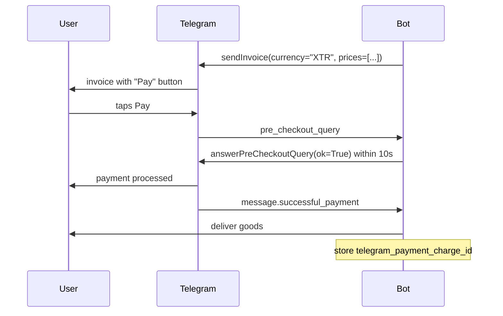

# Telegram Stars: Selling Digital Goods

> **TL;DR:** Digital goods must be sold in Telegram Stars (`currency="XTR"`, empty `provider_token`). You must answer `pre_checkout_query` within 10 seconds, then deliver on `successful_payment` and store `telegram_payment_charge_id` for refunds.
> **Applies to:** Bot API 10.5 · python-telegram-bot 22.8 · Last verified 2026-11-26

## 1. The flow



## 2. Send the invoice

```python
from telegram import LabeledPrice

await context.bot.send_invoice(
    chat_id=chat_id,
    title="Premium month",              # 1-32 characters
    description="30 days of premium",   # 1-255 characters
    payload="premium-30d-<user_id>",    # 1-128 bytes, your idempotency key
    currency="XTR",
    prices=[LabeledPrice("Premium month", 150)],   # exactly one item for XTR
    # provider_token is empty for digital goods
)
```

Invoices with a pay button can be sent to private chats, groups and channels.

## 3. Answer the pre-checkout

```python
async def pre_checkout(update, context):
    q = update.pre_checkout_query
    if q.invoice_payload.startswith("premium-30d-"):
        await q.answer(ok=True)
    else:
        await q.answer(ok=False, error_message="Unknown product. Nothing was charged.")
```

| Rule | Detail |
| :--- | :--- |
| Deadline | **10 seconds** after the update arrives, or the payment is cancelled |
| What to check | payload, amount, currency, user eligibility |
| What not to do | deliver the goods here — wait for `successful_payment` |

## 4. Deliver on success

```python
async def on_paid(update, context):
    p = update.message.successful_payment
    if p is None:
        return
    if await db.payment_exists(p.telegram_payment_charge_id):
        return                                  # duplicate delivery
    await db.insert_payment(p.telegram_payment_charge_id, p.invoice_payload, p.total_amount)
    await grant_access(p.invoice_payload)
```

Always verify the `successful_payment` matches an invoice you created (payload + amount), and make delivery idempotent — see [../03-state/03-idempotent-updates.md](../03-state/03-idempotent-updates.md).

## 5. Refunds

```python
await context.bot.refund_star_payment(
    user_id=user_id,
    telegram_payment_charge_id=charge_id,
)
```

That is why the charge id must be stored.

## 6. Physical goods vs digital goods

| Goods | Currency | `provider_token` |
| :--- | :--- | :--- |
| Digital (subscriptions, features, content) | `XTR` (Stars) | empty |
| Physical goods and services | fiat via a payment provider | required |

If you are unsure which applies, read the Telegram Bot Platform Developer Terms of Service; misclassifying digital goods as physical is a policy violation, not just a technical one.

## 7. Testing

You can test Stars payments in a test environment without spending real money. Verify:

- the invoice renders and the amount matches,
- a rejected pre-checkout cancels cleanly,
- duplicate `successful_payment` does not grant twice,
- a refund succeeds using the stored charge id.

## 8. Pitfalls

- **Slow pre-checkout** — network calls before `answer()` can exceed 10 s.
- **No idempotency** — Telegram may re-deliver; users get two months for one payment.
- **Trusting the client** — the payload must be validated server-side.
- **Forgetting `provider_token`** — leaving a stale provider token on a Stars invoice causes errors.

## Sources

- https://core.telegram.org/bots/payments-stars
- https://core.telegram.org/bots/api#sendinvoice
- https://core.telegram.org/bots/api#answerprecheckoutquery
- https://core.telegram.org/bots/api#refundstarpayment
