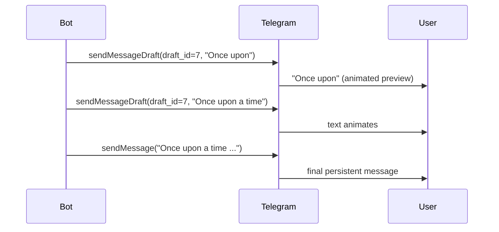

# Streaming Replies with `sendMessageDraft`

> **TL;DR:** `sendMessageDraft` shows a partial message while you generate it, but it is a ~30 second ephemeral preview. When generation finishes you **must** call `sendMessage` with the final text or the message disappears.
> **Applies to:** Bot API 10.5 · python-telegram-bot 22.8 (`send_message_draft`) · Last verified 2026-11-26

## 1. Why it exists

LLM answers take seconds. Users prefer to see text appear. Before Bot API 9.3 the only option was editing a message repeatedly, which is rate-limited and noisy. Drafts are a purpose-built preview channel.



## 2. Parameters

| Parameter | Notes |
| :--- | :--- |
| `chat_id` | private chat only |
| `draft_id` | non-zero. Same id animates; a new id replaces without animation |
| `text` | 0–4096 characters after entity parsing; empty shows "Thinking…" |
| `message_thread_id` | optional, for topics |
| `parse_mode` / `entities` | same formatting rules as `sendMessage` |
| `can_stop` | show a stop button; you then receive `stopped_message_generation` |
| `keep_on_stop` | keep the draft visible when stopped (still temporary) |

## 3. Implementation

```python
draft_id = random.randint(1, 2**31 - 1)

for chunk in stream_from_llm(prompt):
    await context.bot.send_message_draft(
        chat_id=chat_id,
        draft_id=draft_id,
        text=chunk[:4096],
    )

final = chunk[:4096]
await context.bot.send_message(chat_id=chat_id, text=final)   # persist
```

`examples/09_streaming_draft.py` is a runnable version.

## 4. Handling "stop"

With `can_stop=True`, the user can abort. You receive an update whose `stopped_message_generation` field is set; stop generating and either send what you have or send nothing.

```python
async def on_stopped(update, context):
    if update.stopped_message_generation:
        context.chat_data["cancel_generation"] = True
```

## 5. Pitfalls

| Pitfall | Result |
| :--- | :--- |
| Never sending the final `sendMessage` | the message vanishes |
| Updating more than ~10×/second | rate limits; throttle to word or 100–200 ms chunks |
| Draft longer than 4096 | error; truncate |
| Draft in a group | drafts are for private chats |
| Using a new `draft_id` each chunk | no animation, flicker |

## 6. Library support

`python-telegram-bot` 22.8 exposes `Bot.send_message_draft` (Bot API 10.0 surface). If a future parameter is missing, call the endpoint directly:

```python
await context.bot.do_api_request(
    "sendMessageDraft",
    {"chat_id": chat_id, "draft_id": draft_id, "text": text, "can_stop": True},
)
```

## Sources

- https://core.telegram.org/bots/api/methods/sendmessagedraft.md
- https://core.telegram.org/bots/api-changelog (9.3, 10.3 `can_stop`/`keep_on_stop`, `stopped_message_generation`)
