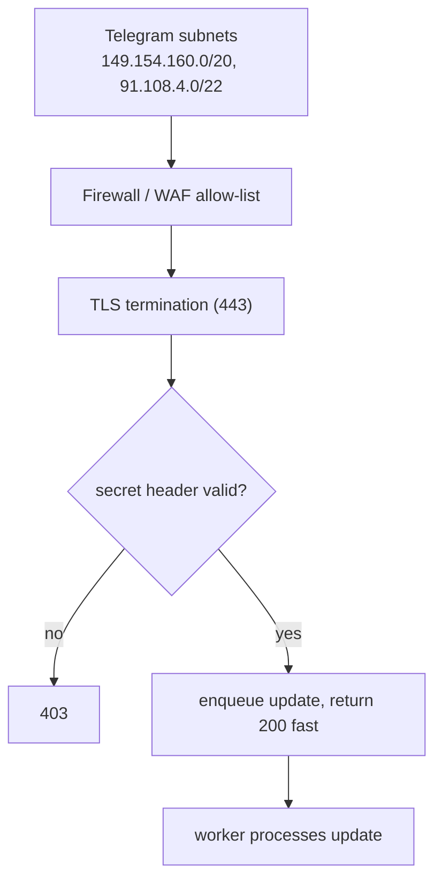

# Webhook and Secret Hardening

> **TL;DR:** Set `secret_token`, allow only Telegram's subnets, validate the `X-Telegram-Bot-Api-Secret-Token` header, keep the endpoint fast, and never put the bot token in the URL path.
> **Applies to:** Bot API 10.5 · python-telegram-bot 22.8 · Last verified 2026-11-26

## 1. Defence layers



| Layer | Purpose | Failure mode it prevents |
| :--- | :--- | :--- |
| HTTPS + valid certificate | confidentiality, Telegram requirement | token/update sniffing |
| Source IP allow-list | only Telegram can post | random internet POSTs |
| `secret_token` | proves the caller registered the webhook | replay from a leaked URL |
| Fast 200 | avoids Telegram retries | duplicate updates |
| Path secrecy | not a security control | none — do not rely on it |

## 2. Set the secret

```python
from tgkit.config import generate_webhook_secret

secret = generate_webhook_secret(48)   # [A-Za-z0-9_-], 1-256 chars
await bot.set_webhook(
    url="https://bot.example.com/telegram",
    secret_token=secret,
    allowed_updates=["message", "callback_query"],
    max_connections=40,
    drop_pending_updates=False,
)
```

Telegram then sends `X-Telegram-Bot-Api-Secret-Token: <secret>` on every request. python-telegram-bot's webhook server rejects requests without it when you pass `secret_token` to `run_webhook`.

If you terminate TLS in front (nginx, Caddy), verify the header there too:

```nginx
location /telegram {
    if ($http_x_telegram_bot_api_secret_token != "REPLACE_ME") { return 403; }
    proxy_pass http://127.0.0.1:8443/telegram;
    proxy_set_header Host $host;
    proxy_set_header X-Forwarded-For $remote_addr;
}
```

## 3. Firewall

```bash
# ufw example: only Telegram may reach the webhook port
ufw allow from 149.154.160.0/20 to any port 8443 proto tcp
ufw allow from 91.108.4.0/22  to any port 8443 proto tcp
```

The ranges can change; re-check the webhook guide when something stops working.

## 4. Return fast

Telegram retries when the endpoint is slow or errors. Do the minimum inline: validate, enqueue, return `200`. Heavy work belongs in a worker.

| Pattern | Result |
| :--- | :--- |
| Validate → enqueue → 200 | no retries, duplicates handled by idempotency |
| Do everything inline | retries under load, duplicate side effects |
| Return 500 on a handler bug | Telegram retries the same update forever |

## 5. Never do this

| Anti-pattern | Why |
| :--- | :--- |
| Token in the URL path (`/bot<token>`) | leaks in proxy logs and screenshots |
| No secret token | anyone can POST fake updates |
| `0.0.0.0` without a firewall | exposes the app server directly |
| Logging full request headers | logs the secret |
| Accepting updates over HTTP | Telegram requires HTTPS; a plain endpoint is someone else's bot |

## 6. Verify the setup

```python
info = await bot.get_webhook_info()
print(info.url, info.pending_update_count, info.last_error_message, info.max_connections)
```

Healthy: `pending_update_count` near zero, no `last_error_message`, URL exactly yours.

## Sources

- https://core.telegram.org/bots/webhooks
- https://core.telegram.org/bots/api#setwebhook (`secret_token`, `max_connections`)
- https://core.telegram.org/bots/api#getwebhookinfo
