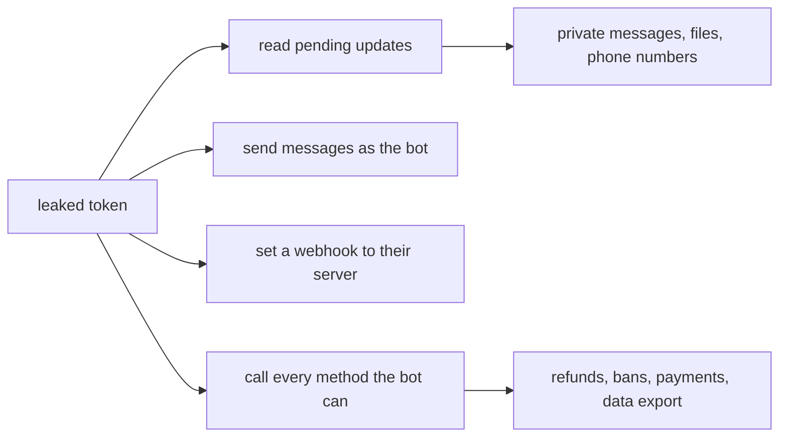

# Token Leak Response

> **TL;DR:** Revoke with `/revoke` in @BotFather immediately, then assume the attacker read pending updates, sent messages and changed the webhook. Rotate everything the bot could reach.
> **Applies to:** Bot API 10.5 · python-telegram-bot 22.8 · Last verified 2026-11-26

## 1. First 10 minutes

| Step | Action | Why |
| :--- | :--- | :--- |
| 1 | @BotFather → `/mybots` → bot → **API Token** → **Revoke current token** | invalidates the leaked token instantly |
| 2 | Deploy the new token from your secret manager | the bot comes back online |
| 3 | `getWebhookInfo` | check whether the URL was changed |
| 4 | `deleteWebhook` then re-set yours | removes any attacker webhook |
| 5 | Review `getUpdates` backlog expectations | pending updates may have been consumed |
| 6 | Rotate secrets the bot had access to | DB passwords, API keys, signing keys |

```python
# after rotating
info = await bot.get_webhook_info()
print(info.url, info.last_error_message)
await bot.delete_webhook(drop_pending_updates=False)
await bot.set_webhook(url=MY_URL, secret_token=MY_SECRET)
```

## 2. What the attacker could do



Treat it as a full compromise of the bot account, not just "someone can send messages".

## 3. Where tokens leak

| Source | Prevention |
| :--- | :--- |
| Committed `.env` or source | `.gitignore`, secret scanning, pre-commit hooks |
| Debug logs of HTTP clients | log level WARNING for `httpx`, redact URLs |
| Error trackers (Sentry etc.) | scrub headers and URLs |
| Screenshots and support tickets | never paste the token |
| CI variables echoed | `set +x`, mask secrets |
| Public notebooks | do not put tokens in cells |

```python
import logging
logging.getLogger("httpx").setLevel(logging.WARNING)

from tgkit.config import redact
logger.info("calling API: %s", redact(url))
```

## 4. If it was committed to git

1. Revoke first. History rewriting does not help a token that is already public.
2. Remove it from history (`git filter-repo`) or rotate and leave the old value in history — rotation is what matters.
3. Enable GitHub secret scanning / push protection on the repository.
4. Audit the bot's recent actions: messages sent, members banned, payments refunded.

## 5. Post-incident checklist

- [ ] New token in the secret manager, old one revoked
- [ ] Webhook URL and secret verified
- [ ] All credentials the bot could read rotated
- [ ] Users notified if their data may have been read
- [ ] Logs reviewed for outbound calls to unknown hosts
- [ ] Secret scanning enabled on the repo
- [ ] A short write-up added to the incident log

## Sources

- https://core.telegram.org/bots/features#botfather (`/revoke`)
- https://core.telegram.org/bots/api#getwebhookinfo
- https://core.telegram.org/bots/api#deletewebhook
