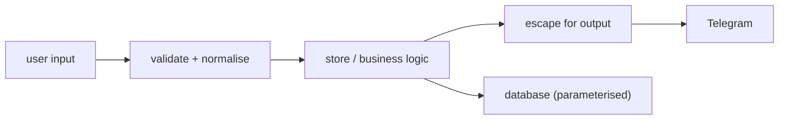

# Validating User Input

> **TL;DR:** Everything from a user is untrusted: text, names, files, callback data, `initData`, deep-link payloads. Validate with allow-lists, escape at the output, and never build a shell command, SQL query or file path from raw input.
> **Applies to:** Bot API 10.5 · python-telegram-bot 22.8 · Last verified 2026-11-26

## 1. Trust boundaries



| Input | Trusted? | Notes |
| :--- | :--- | :--- |
| `message.text` | no | can contain anything, including markup |
| `user.first_name` | no | HTML/Markdown injection vector |
| `callback_data` | no | user can replay/modify in some clients; treat as untrusted |
| `initData` | only after HMAC/Ed25519 validation | see [../04-advanced/02-miniapp-initdata-validation.md](../04-advanced/02-miniapp-initdata-validation.md) |
| `file_id` | from Telegram, but check type/size | do not assume it is what you expect |
| deep-link payload | no | user-typed |
| `chat.id`, `user.id` | yes, as identifiers | still authorise actions |

## 2. Text and formatting

```python
from html import escape
await update.message.reply_text(f"<b>{escape(name)}</b>", parse_mode="HTML")
```

Never interpolate raw text into HTML/MarkdownV2. See [../02-interaction/01-formatting-parse-modes.md](../02-interaction/01-formatting-parse-modes.md).

## 3. Numbers, enums and lengths

```python
import re

USERNAME = re.compile(r"^[A-Za-z0-9_]{3,32}$")

def parse_username(raw: str | None) -> str:
    if not raw or not USERNAME.fullmatch(raw.strip()):
        raise ValueError("invalid username")
    return raw.strip()
```

| Rule | Example |
| :--- | :--- |
| allow-list characters | `[A-Za-z0-9_]{3,32}` |
| bounded length | `1 <= len(text) <= 4096` |
| enum membership | `choice in {"yes", "no"}` |
| numeric range | `0 < amount <= MAX_PRICE` (your own cap) |

## 4. Never build these from input

| Danger | Wrong | Right |
| :--- | :--- | :--- |
| Shell | `os.system(f"convert {path}")` | `subprocess.run(["convert", path], shell=False)` |
| SQL | `f"SELECT * FROM users WHERE id = {uid}"` | parameterised query |
| Path | `open(f"uploads/{name}")` | hash the name, ignore the original |
| URL fetch | `requests.get(user_url)` | allow-list hosts, block private IPs (SSRF) |
| Template | `eval(user_text)` | never |

## 5. File uploads

```python
ALLOWED = {"application/pdf", "image/png", "image/jpeg"}
MAX = 10 * 1024 * 1024

if doc.mime_type not in ALLOWED or (doc.file_size or 0) > MAX:
    await update.message.reply_text("Unsupported file.")
    return
```

Do not trust the extension. If you serve uploads back, serve them from a separate origin with `Content-Disposition: attachment`.

## 6. Authorisation, not just validation

Validation says "this is well-formed". Authorisation says "this user may do it".

```python
if update.effective_user.id not in ADMIN_IDS:
    await update.effective_message.reply_text("Not available.")
    return
```

Check it in the handler, not only in the keyboard: users can call commands directly.

## 7. Logging user input

- Never log full message content by default.
- If you must, redact identifiers and truncate.
- Comply with the retention rules that apply to you.

## Sources

- https://core.telegram.org/bots/api#message
- https://core.telegram.org/bots/webapps#validating-data-received-via-the-mini-app
- https://owasp.org/www-project-top-ten/
