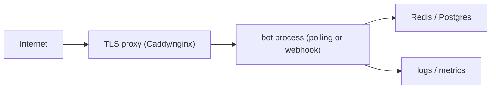

# Deployment: Docker and systemd

> **TL;DR:** One process per bot, secrets from the environment, a health check that actually calls `getMe`, and restart-on-failure. Use polling for simplicity, webhooks behind a TLS proxy for scale.
> **Applies to:** Bot API 10.5 · python-telegram-bot 22.8 · Last verified 2026-11-26

## 1. Layout



## 2. Dockerfile

```dockerfile
FROM python:3.12-slim

ENV PYTHONDONTWRITEBYTECODE=1 \
    PYTHONUNBUFFERED=1

WORKDIR /app
COPY pyproject.toml README.md ./
COPY src ./src
RUN pip install --no-cache-dir .

COPY examples ./examples
USER 10001
CMD ["python", "examples/08_production_template.py"]
```

Notes:

- `PYTHONUNBUFFERED=1` so logs appear immediately.
- Run as a non-root user.
- Never `COPY .env`; inject secrets at runtime.

## 3. Compose

```yaml
services:
  bot:
    build: .
    restart: unless-stopped
    env_file: [.env]
    environment:
      - WEBHOOK_LISTEN=0.0.0.0
      - WEBHOOK_PORT=8443
    ports: ["127.0.0.1:8443:8443"]
    healthcheck:
      test: ["CMD", "python", "-c", "import os,urllib.request;urllib.request.urlopen(f'https://api.telegram.org/bot{os.environ[\"BOT_TOKEN\"]}/getMe', timeout=5)"]
      interval: 60s
      timeout: 10s
      retries: 3
```

Ports are bound to `127.0.0.1` and exposed through the TLS proxy.

## 4. systemd (no Docker)

```ini
[Unit]
Description=Telegram bot
After=network-online.target
Wants=network-online.target

[Service]
Type=simple
User=bot
WorkingDirectory=/opt/bot
EnvironmentFile=/etc/bot/env
ExecStart=/opt/bot/.venv/bin/python -m bot.main
Restart=always
RestartSec=5
NoNewPrivileges=true
PrivateTmp=true
ProtectSystem=strict
ProtectHome=true
ReadWritePaths=/var/lib/bot

[Install]
WantedBy=multi-user.target
```

`Restart=always` plus `NoNewPrivileges` covers most single-host deployments.

## 5. Configuration rules

| Rule | Reason |
| :--- | :--- |
| Secrets only from env/secret manager | no secrets in images or git |
| One bot token per process | two pollers split updates |
| Fail fast on a bad token | `getMe` at startup |
| Graceful shutdown | let in-flight updates finish |
| Pin dependency versions | Bot API changes break parsers |

## 6. Health checks

A process that is running is not necessarily healthy. A good check calls `getMe` (cheap, authenticated) and verifies the webhook when in webhook mode.

```python
me = await app.bot.get_me()
assert me.username
```

## 7. Release checklist

- [ ] `getMe` succeeds with the deployed token
- [ ] Webhook URL and secret match the environment
- [ ] Logs are shipped somewhere durable
- [ ] Restart policy set
- [ ] Alerts on 401/409/429 spikes
- [ ] Database migrations applied before start

## Sources

- https://core.telegram.org/bots/webhooks
- https://docs.python-telegram-bot.org/en/stable/telegram.ext.application.html
