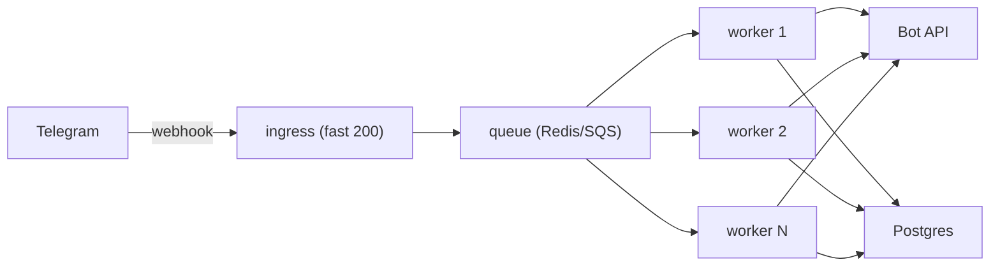

# Scaling: Queues, Workers and Sharding

> **TL;DR:** One process handles a surprising amount. When it does not, put a queue between Telegram and your workers, keep per-chat ordering, and shard by `chat_id` — never run two pollers on the same token.
> **Applies to:** Bot API 10.5 · python-telegram-bot 22.8 · Last verified 2026-11-26

## 1. Growth stages

| Stage | Users | Shape |
| :--- | :--- | :--- |
| 1 | < 10k | one process, polling, SQLite |
| 2 | 10k–100k | one process, webhook, Postgres + Redis |
| 3 | 100k+ | webhook → queue → N workers, sharded by chat |
| 4 | millions | multiple bot processes (different tokens or webhook fan-out), dedicated media pipeline |

## 2. Stage 3 architecture



Ingress does three things: verify the secret header, enqueue the update, return `200`. Workers do the rest.

## 3. Ordering

Telegram does not guarantee global order, but users expect their own messages to be processed in order.

| Approach | Ordering |
| :--- | :--- |
| One queue, many workers | no ordering |
| Partition by `chat_id` | per-chat order preserved |
| Per-chat lock in the worker | per-chat order, at the cost of concurrency |

Partitioning by `chat_id` (or `user_id` for private chats) is the usual answer.

## 4. Idempotency at scale

Every worker must claim `update_id` before acting: [../03-state/03-idempotent-updates.md](../03-state/03-idempotent-updates.md). A queue gives you at-least-once delivery, not exactly-once.

## 5. Rate limits at scale

| Limit | Implication |
| :--- | :--- |
| ~30 messages/second overall | cap your senders globally (a token bucket in Redis) |
| 1 message/second per chat | pace per chat |
| 20 messages/minute per group | pace per group |

A single global token bucket is the simplest correct design:

```python
# Redis token bucket, roughly
allowed = await redis.eval(LUA_TOKEN_BUCKET, 1, "tg:global", rate, capacity, now)
```

## 6. Sharding strategies

| Strategy | When |
| :--- | :--- |
| Partition by chat | almost always |
| Separate bots per product | different tokens, clean isolation |
| Read replicas for queries | heavy dashboards |
| Object storage for media | never proxy large files through the bot |

## 7. Webhook fan-out

Telegram posts to **one** URL. To run several webhook workers:

1. Point Telegram at your ingress/load balancer.
2. Ingress verifies the secret, enqueues, returns `200`.
3. Workers pull from the queue.

Do not point Telegram at a load balancer that forwards directly to app workers without idempotency: retries and duplicate deliveries will hit different workers.

## 8. Capacity checklist

- [ ] Queue depth and age alerted
- [ ] Worker concurrency tuned to DB pool size
- [ ] Global send rate capped below Telegram's limit
- [ ] Per-chat ordering preserved
- [ ] Idempotency durable across restarts
- [ ] Media handled out of band

## Sources

- https://core.telegram.org/bots/faq#broadcasting-to-users
- https://core.telegram.org/bots/webhooks
