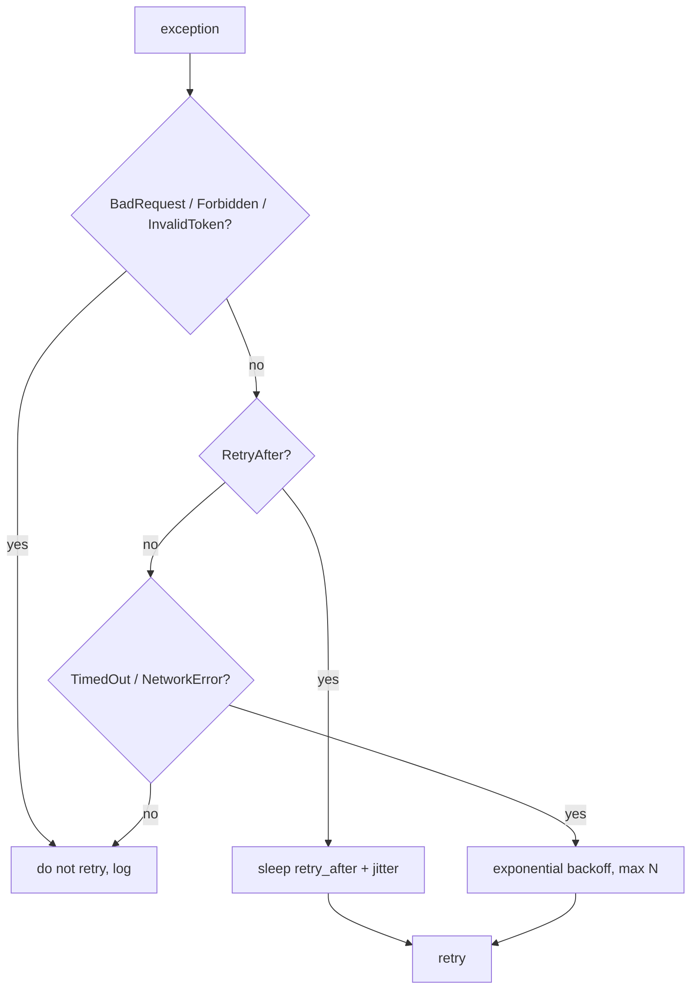

# Errors, 429s and Retries

> **TL;DR:** Distinguish "never retry" (`BadRequest`, `Forbidden`, `InvalidToken`) from "retry with backoff" (`TimedOut`, `NetworkError`, `RetryAfter`). Retry idempotent calls freely; think twice before retrying a send.
> **Applies to:** Bot API 10.5 · python-telegram-bot 22.8 · Last verified 2026-11-26

## 1. Error classes

| Exception | HTTP | Retry? | Typical cause |
| :--- | :--- | :--- | :--- |
| `InvalidToken` | 401 | no | wrong/revoked token |
| `Forbidden` | 403 | no | blocked by user, kicked from chat, no rights |
| `BadRequest` | 400 | no | malformed request, bad entities, too long |
| `ChatMigrated` | 400 | once, to the new id | group upgraded to supergroup |
| `RetryAfter` | 429 | yes, after `retry_after` | rate limit |
| `TimedOut` | — | maybe | slow network |
| `NetworkError` | — | maybe | DNS, connection reset |
| `Conflict` | 409 | no | two pollers on one token, or webhook + polling |

```python
from telegram.error import BadRequest, ChatMigrated, Conflict, Forbidden, InvalidToken
```

## 2. Retry policy



```python
from tgkit.retry import call_with_retry

await call_with_retry(lambda: bot.get_me(), max_attempts=3)
```

`RetryAfter.retry_after` is an `int` in python-telegram-bot 22.8 by default, and a
`datetime.timedelta` when `PTB_TIMEDELTA=1` is set (the default in a future major version). Use
`tgkit.retry.retry_after_seconds(exc.retry_after)` or `exc.retry_after.total_seconds()` so both
forms work.

## 3. The duplicate-send problem

If `sendMessage` times out, the message may still have been delivered. Retrying can post it twice.

| Call type | Safe to retry blindly? |
| :--- | :--- |
| `getMe`, `getChat`, `getFile` | yes |
| `editMessageText` | mostly (idempotent result, may say "not modified") |
| `sendMessage` | no — de-duplicate or accept duplicates |
| `refundStarPayment` | no — check state first |

For sends, prefer at-most-once with a visible failure over at-least-once duplicates.

## 4. ChatMigrated

When a group becomes a supergroup, the `chat_id` changes:

```python
try:
    await bot.send_message(old_chat_id, text)
except ChatMigrated as exc:
    new_id = exc.new_chat_id
    await db.remap_chat(old_chat_id, new_id)
    await bot.send_message(new_id, text)
```

## 5. Conflict

`Conflict: terminated by other getUpdates request` means two processes are polling the same token. Kill one. If you meant to use webhooks, `deleteWebhook` first.

## 6. Error handler

```python
async def on_error(update, context):
    err = context.error
    if isinstance(err, (Forbidden, InvalidToken, BadRequest)):
        logger.warning("permanent error: %s", err)
        return
    logger.exception("transient error", exc_info=err)
```

Register it with `app.add_error_handler(on_error)` and alert on unexpected exception types.

## Sources

- https://docs.python-telegram-bot.org/en/stable/telegram.error.html
- https://core.telegram.org/bots/api#making-requests
- https://core.telegram.org/bots/faq#long-polling-gives-me-the-same-updates-again-and-again
