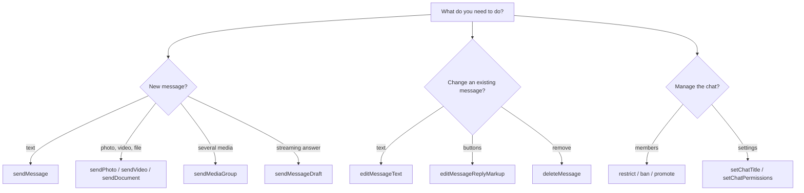

# Bot API Method Cheatsheet

> **TL;DR:** Find the method by the job you need to do, then check its limits in the [Limits Cheatsheet](../01-foundations/05-limits-cheatsheet.md). The official method reference is authoritative; this page is the index you keep open while coding.
> **Applies to:** Bot API 10.5 · python-telegram-bot 22.8 · Last verified 2026-11-26

## 1. How to read this page

Methods are grouped by **job**, not alphabetically. Every Bot API method has a snake_case
counterpart on `telegram.Bot` (`sendMessage` → `bot.send_message`, `answerCallbackQuery` →
`bot.answer_callback_query`). If a method is newer than the library, call the endpoint directly:

```python
if not hasattr(bot, "send_rich_message"):
    result = await bot.do_api_request("sendRichMessage", {"chat_id": chat_id, "rich_message": payload})
```

See [Bot API 10.x Changes](../04-advanced/07-bot-api-10-changes.md) for `do_api_request` and the
version timeline. For parameters and return types, always open the linked official reference.



## 2. Sending messages

| Method | Use it for | Watch out |
| :--- | :--- | :--- |
| [`sendMessage`](https://core.telegram.org/bots/api#sendmessage) | Text, up to **4096** characters | `parse_mode` or `entities`; link previews are controlled by `link_preview_options` |
| [`sendPhoto`](https://core.telegram.org/bots/api#sendphoto) | One photo by `file_id`, URL or upload | **10 MB** upload limit; caption up to **1024** characters |
| [`sendAudio`](https://core.telegram.org/bots/api#sendaudio) | Music and audio files | Shows as a music player; metadata is read from the file |
| [`sendDocument`](https://core.telegram.org/bots/api#senddocument) | Any file, sent as a document | **50 MB** bot upload; **20 MB** download via `getFile` |
| [`sendVideo`](https://core.telegram.org/bots/api#sendvideo) | Video with optional caption | `supports_streaming` is a hint, not a guarantee |
| [`sendAnimation`](https://core.telegram.org/bots/api#sendanimation) | GIF or silent MP4 | Telegram converts and may re-encode |
| [`sendVoice`](https://core.telegram.org/bots/api#sendvoice) | Voice message (OGG/OPUS) | Duration and waveform are optional metadata |
| [`sendVideoNote`](https://core.telegram.org/bots/api#sendvideonote) | Round video message | Square video; keep it short |
| [`sendMediaGroup`](https://core.telegram.org/bots/api#sendmediagroup) | Album of **2–10** photos/videos | One caption per group in practice; mixing types is limited |
| [`sendPaidMedia`](https://core.telegram.org/bots/api#sendpaidmedia) | Paid photos/videos for Stars | Requires `star_count`; see [Telegram Stars](../04-advanced/03-stars-payments.md) |
| [`sendLivePhoto`](https://core.telegram.org/bots/api#sendlivephoto) | Live photo (still + short video) | Newer surface; check client support |
| [`sendLocation`](https://core.telegram.org/bots/api#sendlocation) | A map point | Coordinates are floats; no address |
| [`sendVenue`](https://core.telegram.org/bots/api#sendvenue) | A named place with address | `foursquare_id` is optional and legacy |
| [`sendContact`](https://core.telegram.org/bots/api#sendcontact) | Phone contact card | The user must still consent to being contacted |
| [`sendPoll`](https://core.telegram.org/bots/api#sendpoll) | Poll or quiz | Quizzes need `correct_option_ids`; see [Polls](../02-interaction/08-polls-and-quizzes.md) |
| [`sendChecklist`](https://core.telegram.org/bots/api#sendchecklist) | Checklist message | Editable with `editMessageChecklist` |
| [`sendDice`](https://core.telegram.org/bots/api#senddice) | Animated dice, darts, basketball | Result is random; use it for fun, not fairness claims |
| [`sendGame`](https://core.telegram.org/bots/api#sendgame) | A game message | Scores are set with `setGameScore` |
| [`sendInvoice`](https://core.telegram.org/bots/api#sendinvoice) | Payment invoice | Stars use `currency="XTR"` and an empty `provider_token` |
| [`sendRichMessage`](https://core.telegram.org/bots/api#sendrichmessage) | Structured rich message | Newer than many wrappers; use `do_api_request` if needed |

## 3. Streaming and ephemeral messages

| Method | Use it for | Watch out |
| :--- | :--- | :--- |
| [`sendMessageDraft`](https://core.telegram.org/bots/api#sendmessagedraft) | Stream a partial text answer | A **~30 second** preview; finish with `sendMessage` or it disappears |
| [`sendRichMessageDraft`](https://core.telegram.org/bots/api#sendrichmessagedraft) | Stream a rich message | Same preview rule; see [Streaming Replies](../04-advanced/04-streaming-ai-replies.md) |
| [`editEphemeralMessageText`](https://core.telegram.org/bots/api#editephemeralmessagetext) | Edit an ephemeral message | Only the sender can edit it |
| [`editEphemeralMessageCaption`](https://core.telegram.org/bots/api#editephemeralmessagecaption) | Change an ephemeral caption | Media cannot be replaced by a caption edit |
| [`editEphemeralMessageMedia`](https://core.telegram.org/bots/api#editephemeralmessagemedia) | Replace ephemeral media | Re-uploading costs bandwidth; prefer `file_id` |
| [`editEphemeralMessageReplyMarkup`](https://core.telegram.org/bots/api#editephemeralmessagereplymarkup) | Change ephemeral buttons | Buttons must still fit the 64-byte `callback_data` rule |
| [`deleteEphemeralMessage`](https://core.telegram.org/bots/api#deleteephemeralmessage) | Remove an ephemeral message | Does not delete a normal message |

## 4. Editing, copying and deleting

| Method | Use it for | Watch out |
| :--- | :--- | :--- |
| [`editMessageText`](https://core.telegram.org/bots/api#editmessagetext) | Change the text of your message | Cannot turn a media message into text; use `editMessageCaption` |
| [`editMessageCaption`](https://core.telegram.org/bots/api#editmessagecaption) | Change a caption | Caption limit is **1024** characters |
| [`editMessageMedia`](https://core.telegram.org/bots/api#editmessagemedia) | Replace photo/video/document | The new media must be a supported type |
| [`editMessageReplyMarkup`](https://core.telegram.org/bots/api#editmessagereplymarkup) | Replace or remove buttons | Pass an empty markup to remove them |
| [`editMessageLiveLocation`](https://core.telegram.org/bots/api#editmessagelivelocation) | Move a live location | Only the sender can edit it |
| [`stopMessageLiveLocation`](https://core.telegram.org/bots/api#stopmessagelivelocation) | End a live location | Also available as a keyboard button |
| [`editMessageChecklist`](https://core.telegram.org/bots/api#editmessagechecklist) | Update checklist items | Keep task ids stable |
| [`editMessageWidgetData`](https://core.telegram.org/bots/api#editmessagewidgetdata) | Update a widget message | Widgets have their own data contract |
| [`editSharedWidgetData`](https://core.telegram.org/bots/api#editsharedwidgetdata) | Update shared widget data | Check who owns the shared widget |
| [`deleteMessage`](https://core.telegram.org/bots/api#deletemessage) | Delete one message | In groups, bots can delete their own; admins can delete others. Telegram documents a **48-hour** window |
| [`deleteMessages`](https://core.telegram.org/bots/api#deletemessages) | Delete up to **100** messages | Same permission rules as `deleteMessage` |
| [`copyMessage`](https://core.telegram.org/bots/api#copymessage) | Re-send a message without the forward header | Copies content, not the original author |
| [`copyMessages`](https://core.telegram.org/bots/api#copymessages) | Copy up to **100** messages | Ordering is preserved |
| [`forwardMessage`](https://core.telegram.org/bots/api#forwardmessage) | Forward with attribution | The original chat may hide the link |
| [`forwardMessages`](https://core.telegram.org/bots/api#forwardmessages) | Forward up to **100** messages | Same attribution rules |
| [`setMessageReaction`](https://core.telegram.org/bots/api#setmessagereaction) | Add or replace a reaction | One reaction per bot per message in practice |
| [`deleteMessageReaction`](https://core.telegram.org/bots/api#deletemessagereaction) | Remove your reaction | Does not remove other users' reactions |
| [`deleteAllMessageReactions`](https://core.telegram.org/bots/api#deleteallmessagereactions) | Clear reactions on a message | Requires permission in groups |

## 5. Chats, members and moderation

| Method | Use it for | Watch out |
| :--- | :--- | :--- |
| [`getChat`](https://core.telegram.org/bots/api#getchat) | Chat metadata and pinned message | Returns `ChatFullInfo` |
| [`getChatAdministrators`](https://core.telegram.org/bots/api#getchatadministrators) | List admins and owner | Cache it; do not call on every update |
| [`getChatMemberCount`](https://core.telegram.org/bots/api#getchatmembercount) | Member count | Approximate for very large chats |
| [`getChatMember`](https://core.telegram.org/bots/api#getchatmember) | One member's status and rights | A user not in the chat returns `ChatMemberLeft`/`Banned` |
| [`banChatMember`](https://core.telegram.org/bots/api#banchatmember) | Ban a user | `until_date` makes it a temporary ban |
| [`unbanChatMember`](https://core.telegram.org/bots/api#unbanchatmember) | Lift a ban | Does not re-add the user |
| [`restrictChatMember`](https://core.telegram.org/bots/api#restrictchatmember) | Mute or limit a member | Pass a complete `ChatPermissions` object |
| [`promoteChatMember`](https://core.telegram.org/bots/api#promotechatmember) | Grant admin rights | The bot must be an admin with `can_promote_members` |
| [`setChatAdministratorCustomTitle`](https://core.telegram.org/bots/api#setchatadministratorcustomtitle) | Custom admin title | Only for promoted admins |
| [`banChatSenderChat`](https://core.telegram.org/bots/api#banchatsenderchat) | Ban a channel posting as a sender | Different from banning a user |
| [`unbanChatSenderChat`](https://core.telegram.org/bots/api#unbanchatsenderchat) | Undo a sender-chat ban | — |
| [`approveChatJoinRequest`](https://core.telegram.org/bots/api#approvechatjoinrequest) | Approve a join request | Bot needs `can_invite_users` |
| [`declineChatJoinRequest`](https://core.telegram.org/bots/api#declinechatjoinrequest) | Reject a join request | The user can request again unless banned |
| [`leaveChat`](https://core.telegram.org/bots/api#leavechat) | Make the bot leave | Irreversible without an invite |
| [`setChatTitle`](https://core.telegram.org/bots/api#setchattitle) | Rename a group/channel | Bot needs permission |
| [`setChatDescription`](https://core.telegram.org/bots/api#setchatdescription) | Change the description | Empty string clears it |
| [`setChatPhoto`](https://core.telegram.org/bots/api#setchatphoto) | Set chat photo | Upload or reuse a `file_id` |
| [`deleteChatPhoto`](https://core.telegram.org/bots/api#deletechatphoto) | Remove chat photo | — |
| [`setChatPermissions`](https://core.telegram.org/bots/api#setchatpermissions) | Default member permissions | Does not affect admins |
| [`pinChatMessage`](https://core.telegram.org/bots/api#pinchatmessage) | Pin a message | `disable_notification` avoids a ping |
| [`unpinChatMessage`](https://core.telegram.org/bots/api#unpinchatmessage) | Unpin one message | Omit `message_id` to unpin the latest |
| [`unpinAllChatMessages`](https://core.telegram.org/bots/api#unpinallchatmessages) | Clear all pins | — |
| [`createChatInviteLink`](https://core.telegram.org/bots/api#createchatinvitelink) | New invite link | Set `member_limit` and `expire_date` |
| [`editChatInviteLink`](https://core.telegram.org/bots/api#editchatinvitelink) | Change limits on a link | Cannot change the link itself |
| [`revokeChatInviteLink`](https://core.telegram.org/bots/api#revokechatinvitelink) | Invalidate a link | Existing members stay |
| [`exportChatInviteLink`](https://core.telegram.org/bots/api#exportchatinvitelink) | Get the primary link | Requires admin rights |
| [`createChatSubscriptionInviteLink`](https://core.telegram.org/bots/api#createchatsubscriptioninvitelink) | Paid subscription link | Stars-only; see the payments docs |
| [`editChatSubscriptionInviteLink`](https://core.telegram.org/bots/api#editchatsubscriptioninvitelink) | Change a subscription link | — |
| [`setChatMenuButton`](https://core.telegram.org/bots/api#setchatmenubutton) | Configure the menu button | Per-chat override is possible |
| [`getChatMenuButton`](https://core.telegram.org/bots/api#getchatmenubutton) | Read the current menu button | — |
| [`setChatStickerSet`](https://core.telegram.org/bots/api#setchatstickerset) | Set a group sticker set | Bot must be admin |
| [`deleteChatStickerSet`](https://core.telegram.org/bots/api#deletechatstickerset) | Remove the group sticker set | — |
| [`setChatMemberTag`](https://core.telegram.org/bots/api#setchatmembertag) | Set a member tag | Newer surface; check client support |
| [`verifyChat`](https://core.telegram.org/bots/api#verifychat) | Verify a chat | Requires the right bot account |
| [`removeChatVerification`](https://core.telegram.org/bots/api#removechatverification) | Remove verification | — |

### Forum topics

| Method | Use it for |
| :--- | :--- |
| [`createForumTopic`](https://core.telegram.org/bots/api#createforumtopic) | Create a topic |
| [`editForumTopic`](https://core.telegram.org/bots/api#editforumtopic) | Rename or re-icon a topic |
| [`closeForumTopic`](https://core.telegram.org/bots/api#closeforumtopic) / [`reopenForumTopic`](https://core.telegram.org/bots/api#reopenforumtopic) | Toggle a topic |
| [`deleteForumTopic`](https://core.telegram.org/bots/api#deleteforumtopic) | Delete a topic and its messages |
| [`hideGeneralForumTopic`](https://core.telegram.org/bots/api#hidegeneralforumtopic) / [`unhideGeneralForumTopic`](https://core.telegram.org/bots/api#unhidegeneralforumtopic) | Hide or show "General" |
| [`closeGeneralForumTopic`](https://core.telegram.org/bots/api#closegeneralforumtopic) / [`reopenGeneralForumTopic`](https://core.telegram.org/bots/api#reopengeneralforumtopic) | Close or reopen "General" |
| [`unpinAllForumTopicMessages`](https://core.telegram.org/bots/api#unpinallforumtopicmessages) | Clear pins in a topic |
| [`unpinAllGeneralForumTopicMessages`](https://core.telegram.org/bots/api#unpinallgeneralforumtopicmessages) | Clear pins in "General" |

## 6. Bot profile, commands and menu

| Method | Use it for | Watch out |
| :--- | :--- | :--- |
| [`getMe`](https://core.telegram.org/bots/api#getme) | Identity check and health probe | Cheap; safe to call at startup |
| [`logOut`](https://core.telegram.org/bots/api#logout) | Log out from the local Bot API server | Not the same as revoking the token |
| [`close`](https://core.telegram.org/bots/api#close) | Close the bot instance before moving it | Required when migrating a local server |
| [`setMyCommands`](https://core.telegram.org/bots/api#setmycommands) | Publish the command menu | Scopes and language codes; max **100** per scope |
| [`getMyCommands`](https://core.telegram.org/bots/api#getmycommands) | Read the command menu | — |
| [`deleteMyCommands`](https://core.telegram.org/bots/api#deletemycommands) | Clear the menu | Can target a scope/language |
| [`setMyName`](https://core.telegram.org/bots/api#setmyname) / [`getMyName`](https://core.telegram.org/bots/api#getmyname) | Bot display name | Localisable |
| [`setMyDescription`](https://core.telegram.org/bots/api#setmydescription) / [`getMyDescription`](https://core.telegram.org/bots/api#getmydescription) | Intro shown before `/start` | Localisable |
| [`setMyShortDescription`](https://core.telegram.org/bots/api#setmyshortdescription) / [`getMyShortDescription`](https://core.telegram.org/bots/api#getmyshortdescription) | Short profile blurb | Localisable |
| [`setMyProfilePhoto`](https://core.telegram.org/bots/api#setmyprofilephoto) / [`removeMyProfilePhoto`](https://core.telegram.org/bots/api#removemyprofilephoto) | Bot avatar | — |
| [`setMyDefaultAdministratorRights`](https://core.telegram.org/bots/api#setmydefaultadministratorrights) | Rights requested when added to a group | Keep the minimum |
| [`getMyDefaultAdministratorRights`](https://core.telegram.org/bots/api#getmydefaultadministratorrights) | Read those defaults | — |
| [`setMySettings`](https://core.telegram.org/bots/api#setmysettings) | Newer bot settings | Check `hasattr` before calling |
| [`getManagedBotAccessSettings`](https://core.telegram.org/bots/api#getmanagedbotaccesssettings) / [`setManagedBotAccessSettings`](https://core.telegram.org/bots/api#setmanagedbotaccesssettings) | Managed-bot permissions | Newer surface |
| [`getManagedBotToken`](https://core.telegram.org/bots/api#getmanagedbottoken) / [`replaceManagedBotToken`](https://core.telegram.org/bots/api#replacemanagedbottoken) | Managed-bot token lifecycle | Treat tokens as secrets |

## 7. Updates, webhooks and files

| Method | Use it for | Watch out |
| :--- | :--- | :--- |
| [`getUpdates`](https://core.telegram.org/bots/api#getupdates) | Long polling | One poller per token; `limit` is **1–100** |
| [`setWebhook`](https://core.telegram.org/bots/api#setwebhook) | Register a webhook | HTTPS, supported ports, `secret_token` |
| [`deleteWebhook`](https://core.telegram.org/bots/api#deletewebhook) | Go back to polling | `drop_pending_updates` is destructive |
| [`getWebhookInfo`](https://core.telegram.org/bots/api#getwebhookinfo) | Inspect URL, errors and pending count | First stop when updates disappear |
| [`getFile`](https://core.telegram.org/bots/api#getfile) | Resolve a `file_id` to a download path | **20 MB** download limit |
| [`getUserProfilePhotos`](https://core.telegram.org/bots/api#getuserprofilephotos) | Profile photo `file_id`s | Privacy settings may hide them |
| [`getUserProfileAudios`](https://core.telegram.org/bots/api#getuserprofileaudios) | Profile audio list | — |
| [`getStickerSet`](https://core.telegram.org/bots/api#getstickerset) | Sticker set metadata | — |
| [`getCustomEmojiStickers`](https://core.telegram.org/bots/api#getcustomemojistickers) | Resolve custom emoji | Up to 200 ids per call in practice |
| [`getForumTopicIconStickers`](https://core.telegram.org/bots/api#getforumtopiciconstickers) | Icons for forum topics | — |
| [`uploadStickerFile`](https://core.telegram.org/bots/api#uploadstickerfile) | Upload a sticker asset | Format rules differ per sticker type |
| [`createNewStickerSet`](https://core.telegram.org/bots/api#createnewstickerset) | Create a sticker set | Bot must own it |
| [`addStickerToSet`](https://core.telegram.org/bots/api#addstickertoset) | Add a sticker | — |
| [`replaceStickerInSet`](https://core.telegram.org/bots/api#replacestickerinset) | Replace a sticker | — |
| [`deleteStickerFromSet`](https://core.telegram.org/bots/api#deletestickerfromset) | Remove a sticker | — |
| [`setStickerPositionInSet`](https://core.telegram.org/bots/api#setstickerpositioninset) | Reorder | — |
| [`setStickerEmojiList`](https://core.telegram.org/bots/api#setstickeremojilist) | Change emoji associations | — |
| [`setStickerKeywords`](https://core.telegram.org/bots/api#setstickerkeywords) | Search keywords | — |
| [`setStickerMaskPosition`](https://core.telegram.org/bots/api#setstickermaskposition) | Mask placement | — |
| [`setStickerSetTitle`](https://core.telegram.org/bots/api#setstickersettitle) / [`setStickerSetThumbnail`](https://core.telegram.org/bots/api#setstickersetthumbnail) | Set metadata | — |
| [`setCustomEmojiStickerSetThumbnail`](https://core.telegram.org/bots/api#setcustomemojistickersetthumbnail) | Custom emoji thumbnail | — |
| [`deleteStickerSet`](https://core.telegram.org/bots/api#deletestickerset) | Delete a set | Irreversible |

## 8. Inline mode, Mini Apps and widgets

| Method | Use it for | Watch out |
| :--- | :--- | :--- |
| [`answerInlineQuery`](https://core.telegram.org/bots/api#answerinlinequery) | Answer `@bot query` | Max **50** results per answer; `next_offset` for paging |
| [`savePreparedInlineMessage`](https://core.telegram.org/bots/api#savepreparedinlinemessage) | Prepare a message for later sending | — |
| [`savePreparedKeyboardButton`](https://core.telegram.org/bots/api#savepreparedkeyboardbutton) | Prepare a keyboard button | — |
| [`answerWebAppQuery`](https://core.telegram.org/bots/api#answerwebappquery) | Return a result from a Mini App | `web_app_query_id` is one-shot |
| [`answerWidgetQuery`](https://core.telegram.org/bots/api#answerwidgetquery) | Answer a widget query | — |
| [`answerGuestQuery`](https://core.telegram.org/bots/api#answerguestquery) | Answer a guest-bot query | Newer surface |
| [`sendWidget`](https://core.telegram.org/bots/api#sendwidget) / [`sendSharedWidget`](https://core.telegram.org/bots/api#sendsharedwidget) | Send widgets | Check client support |
| [`sendChatJoinRequestWebApp`](https://core.telegram.org/bots/api#sendchatjoinrequestwebapp) | Join-request Web App flow | Requires a configured Web App |

## 9. Payments, Stars and gifts

| Method | Use it for | Watch out |
| :--- | :--- | :--- |
| [`sendInvoice`](https://core.telegram.org/bots/api#sendinvoice) | Send an invoice | Answer pre-checkout within **10 seconds** |
| [`createInvoiceLink`](https://core.telegram.org/bots/api#createinvoicelink) | Shareable invoice link | Same payment flow |
| [`answerShippingQuery`](https://core.telegram.org/bots/api#answershippingquery) | Shipping options | Only for physical goods |
| [`answerPreCheckoutQuery`](https://core.telegram.org/bots/api#answerprecheckoutquery) | Approve or reject a payment | Must answer every query |
| [`getMyStarBalance`](https://core.telegram.org/bots/api#getmystarbalance) | Bot's Stars balance | — |
| [`getStarTransactions`](https://core.telegram.org/bots/api#getstartransactions) | Stars ledger | Paginate with offsets |
| [`refundStarPayment`](https://core.telegram.org/bots/api#refundstarpayment) | Refund a Stars charge | Needs the Telegram payment charge id |
| [`editUserStarSubscription`](https://core.telegram.org/bots/api#edituserstarsubscription) | Manage a Stars subscription | — |
| [`getAvailableGifts`](https://core.telegram.org/bots/api#getavailablegifts) | List gifts on sale | — |
| [`sendGift`](https://core.telegram.org/bots/api#sendgift) | Send a gift | Stars are spent immediately |
| [`giftPremiumSubscription`](https://core.telegram.org/bots/api#giftpremiumsubscription) | Gift Telegram Premium | — |
| [`getUserGifts`](https://core.telegram.org/bots/api#getusergifts) / [`getChatGifts`](https://core.telegram.org/bots/api#getchatgifts) | Read gift collections | — |
| [`getBusinessAccountGifts`](https://core.telegram.org/bots/api#getbusinessaccountgifts) | Business gift collection | — |
| [`getBusinessAccountStarBalance`](https://core.telegram.org/bots/api#getbusinessaccountstarbalance) | Business Stars balance | — |
| [`transferBusinessAccountStars`](https://core.telegram.org/bots/api#transferbusinessaccountstars) | Move Stars from a business account | — |
| [`convertGiftToStars`](https://core.telegram.org/bots/api#convertgifttostars) | Convert a gift | Irreversible |
| [`transferGift`](https://core.telegram.org/bots/api#transfergift) | Transfer a gift | — |
| [`getUniqueGift`](https://core.telegram.org/bots/api#getuniquegift) | Unique gift details | — |
| [`setBusinessAccountGiftSettings`](https://core.telegram.org/bots/api#setbusinessaccountgiftsettings) | Gift settings | — |

## 10. Business accounts

| Method | Use it for |
| :--- | :--- |
| [`getBusinessConnection`](https://core.telegram.org/bots/api#getbusinessconnection) | Inspect a business connection |
| [`readBusinessMessage`](https://core.telegram.org/bots/api#readbusinessmessage) | Mark a business message as read |
| [`deleteBusinessMessages`](https://core.telegram.org/bots/api#deletebusinessmessages) | Delete business messages |
| [`setBusinessAccountName`](https://core.telegram.org/bots/api#setbusinessaccountname) / [`setBusinessAccountUsername`](https://core.telegram.org/bots/api#setbusinessaccountusername) / [`setBusinessAccountBio`](https://core.telegram.org/bots/api#setbusinessaccountbio) | Edit the business profile |
| [`setBusinessAccountProfilePhoto`](https://core.telegram.org/bots/api#setbusinessaccountprofilephoto) / [`removeBusinessAccountProfilePhoto`](https://core.telegram.org/bots/api#removebusinessaccountprofilephoto) | Business avatar |

## 11. Stories, verification and the rest

| Method | Use it for |
| :--- | :--- |
| [`postStory`](https://core.telegram.org/bots/api#poststory) / [`editStory`](https://core.telegram.org/bots/api#editstory) / [`deleteStory`](https://core.telegram.org/bots/api#deletestory) | Manage a bot's stories |
| [`verifyUser`](https://core.telegram.org/bots/api#verifyuser) / [`removeUserVerification`](https://core.telegram.org/bots/api#removeuserverification) | User verification |
| [`setUserEmojiStatus`](https://core.telegram.org/bots/api#setuseremojistatus) | Set a user's emoji status |
| [`getUserChatBoosts`](https://core.telegram.org/bots/api#getuserchatboosts) | Boosts from a user |
| [`approveSuggestedPost`](https://core.telegram.org/bots/api#approvesuggestedpost) / [`declineSuggestedPost`](https://core.telegram.org/bots/api#declinesuggestedpost) | Moderate suggested posts |
| [`setGameScore`](https://core.telegram.org/bots/api#setgamescore) / [`getGameHighscores`](https://core.telegram.org/bots/api#getgamehighscores) | Game scores |
| [`setPassportDataErrors`](https://core.telegram.org/bots/api#setpassportdataerrors) | Telegram Passport validation |

## 12. The methods this handbook uses most

If you only remember ten calls, remember these:

| Job | Method | Page |
| :--- | :--- | :--- |
| Reply to a message | `sendMessage` | [Formatting](../02-interaction/01-formatting-parse-modes.md) |
| Answer a button press | `answerCallbackQuery` | [Callbacks](../02-interaction/03-callback-queries.md) |
| Replace buttons | `editMessageReplyMarkup` | [Keyboards](../02-interaction/02-keyboards-inline-vs-reply.md) |
| Remove a message | `deleteMessage` | [Media](../02-interaction/06-media-and-files.md) |
| Send a photo | `sendPhoto` | [Media](../02-interaction/06-media-and-files.md) |
| Check the bot | `getMe` | [Deployment](../06-production/01-deployment-docker-systemd.md) |
| Inspect the webhook | `getWebhookInfo` | [Webhooks](../05-security/01-webhook-and-secrets.md) |
| Download a file | `getFile` | [Media](../02-interaction/06-media-and-files.md) |
| Publish commands | `setMyCommands` | [Commands](../02-interaction/07-commands-and-menu.md) |
| Approve a payment | `answerPreCheckoutQuery` | [Stars](../04-advanced/03-stars-payments.md) |

## Sources

- https://core.telegram.org/bots/api
- https://core.telegram.org/bots/api-changelog
- https://docs.python-telegram-bot.org/en/stable/telegram.bot.html
