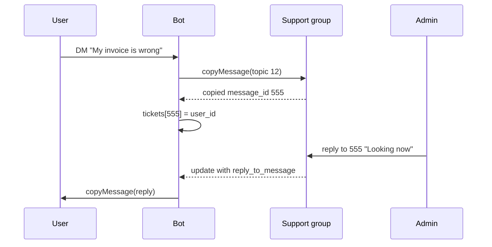

# Recipe: A Support Inbox with Forum Topics

> **TL;DR:** Copy user DMs into one topic of a private support group, store the mapping from the copied message to the user, and let admins reply to that message. Use `copyMessage`, not `forwardMessage`, so the user's account is not exposed to every admin.
> **Applies to:** Bot API 10.5 · python-telegram-bot 22.8 · Last verified 2026-11-26

## 1. What you are building

A private bot receives support questions. Each question is copied into a "Support" topic in a
staff group. An admin replies to the copied message; the bot copies the reply back to the user.
The user never sees the staff group, and the staff do not need the user's username.



Why `copyMessage` instead of `forwardMessage`:

| | `copyMessage` | `forwardMessage` |
| :--- | :--- | :--- |
| Shows the original author | No | Yes, with a link to the profile |
| Keeps formatting and media | Yes | Yes |
| Reply target | The new message | The new message |
| Good for support | Yes | Only if identity disclosure is acceptable |

## 2. Schema

One row per copied message. Keep it small and delete old rows on a schedule.

```sql
CREATE TABLE IF NOT EXISTS tickets (
    support_message_id INTEGER PRIMARY KEY,
    user_id            INTEGER NOT NULL,
    created_at         TEXT NOT NULL DEFAULT CURRENT_TIMESTAMP
);
```

`support_message_id` is unique within the support chat. If you use more than one support chat,
make the primary key `(support_chat_id, support_message_id)`.

## 3. Code

```python
import sqlite3

from telegram import Update
from telegram.ext import Application, CommandHandler, ContextTypes, MessageHandler, filters

SUPPORT_CHAT_ID = -1001234567890   # your private staff group
SUPPORT_TOPIC_ID = 12              # the "Support" topic
ADMIN_IDS = {111111111, 222222222}

conn = sqlite3.connect("support.db")
conn.execute(
    """CREATE TABLE IF NOT EXISTS tickets (
           support_message_id INTEGER PRIMARY KEY,
           user_id INTEGER NOT NULL,
           created_at TEXT NOT NULL DEFAULT CURRENT_TIMESTAMP
       )"""
)


def remember(support_message_id: int, user_id: int) -> None:
    conn.execute(
        "INSERT OR REPLACE INTO tickets (support_message_id, user_id) VALUES (?, ?)",
        (support_message_id, user_id),
    )
    conn.commit()


def lookup(support_message_id: int) -> int | None:
    row = conn.execute(
        "SELECT user_id FROM tickets WHERE support_message_id = ?", (support_message_id,)
    ).fetchone()
    return row[0] if row else None


async def forward_to_support(update: Update, context: ContextTypes.DEFAULT_TYPE) -> None:
    message = update.effective_message
    if message is None or update.effective_user is None:
        return
    copied = await context.bot.copy_message(
        chat_id=SUPPORT_CHAT_ID,
        from_chat_id=message.chat_id,
        message_id=message.message_id,
        message_thread_id=SUPPORT_TOPIC_ID,
    )
    remember(copied.message_id, update.effective_user.id)
    await message.reply_text("Thanks — a human will reply here.")


async def reply_to_user(update: Update, context: ContextTypes.DEFAULT_TYPE) -> None:
    message = update.effective_message
    if message is None or message.reply_to_message is None:
        return
    user_id = lookup(message.reply_to_message.message_id)
    if user_id is None:
        await message.reply_text("I do not have a user for that message.")
        return
    await context.bot.copy_message(
        chat_id=user_id,
        from_chat_id=message.chat_id,
        message_id=message.message_id,
    )


def build_application(token: str) -> Application:
    app = Application.builder().token(token).build()
    app.add_handler(
        MessageHandler(
            filters.Chat(SUPPORT_CHAT_ID) & filters.REPLY & filters.User(ADMIN_IDS),
            reply_to_user,
        )
    )
    app.add_handler(
        MessageHandler(filters.ChatType.PRIVATE & ~filters.COMMAND, forward_to_support)
    )
    return app
```

Register the admin handler **before** the private handler only for clarity; the filters are
disjoint, so order does not change behaviour.

## 4. Operational details

| Question | Answer |
| :--- | :--- |
| Does the bot see admin replies? | Only if privacy mode is disabled in BotFather or the bot is an admin in the group |
| What if an admin replies to the wrong message? | The lookup misses and the bot says so; never guess a recipient |
| How do users send photos or files? | `copyMessage` copies the media and caption; no extra code |
| How do you stop spam? | Rate-limit per user before copying, and mute repeat offenders |
| How long do you keep tickets? | Delete rows older than your support retention window; the Telegram messages remain until deleted |
| What about multiple topics? | Store `(chat_id, message_id)` and route by `message_thread_id` |

The bot must be an **admin** in the support group if you want it to delete messages, pin tickets
or work reliably with topics. Test with a private group first.

## 5. Pitfalls

- **Forwarding leaks identity.** `forwardMessage` shows the user's profile to every admin. Copy
  unless the user explicitly agreed.
- **Replying in the user's DM.** If an admin accidentally messages the bot privately, the update
  has no `reply_to_message`; the handler returns without sending anything.
- **Losing the mapping on restart.** SQLite (or Postgres) is required; an in-memory dict loses
  every open ticket when the process restarts.
- **Copying the bot's own messages.** The private handler ignores commands but not other bots.
  Add `filters.UpdateType.MESSAGE` and a sender check if the bot can be messaged by other bots.
- **Unbounded growth.** Add a daily cleanup job, and never log message text.

## Sources

- https://core.telegram.org/bots/api#copymessage
- https://core.telegram.org/bots/api#forwardmessage
- https://core.telegram.org/bots/features#privacy-mode
- https://docs.python-telegram-bot.org/en/stable/telegram.ext.filters.html
