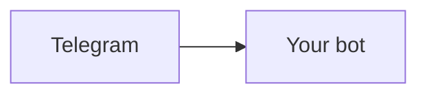

# Page Title

> **TL;DR:** One or two sentences that answer the question this page is about.
> **Applies to:** Bot API 10.5 · python-telegram-bot 22.8 · Last verified 2026-11-26

## 1. Concept

Short explanation. Prefer a table or a Mermaid diagram over long prose.



## 2. Example

```python
from telegram.ext import Application

app = Application.builder().token("123456:ABC-DEF").build()
```

## 3. Pitfalls

- Pitfall one.

## Sources

- https://core.telegram.org/bots/api
